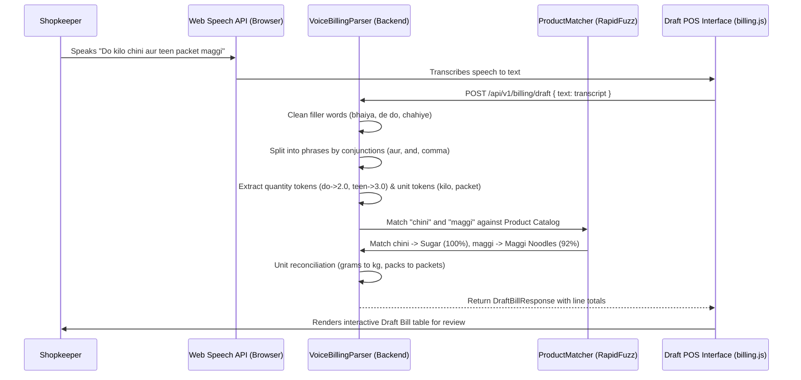
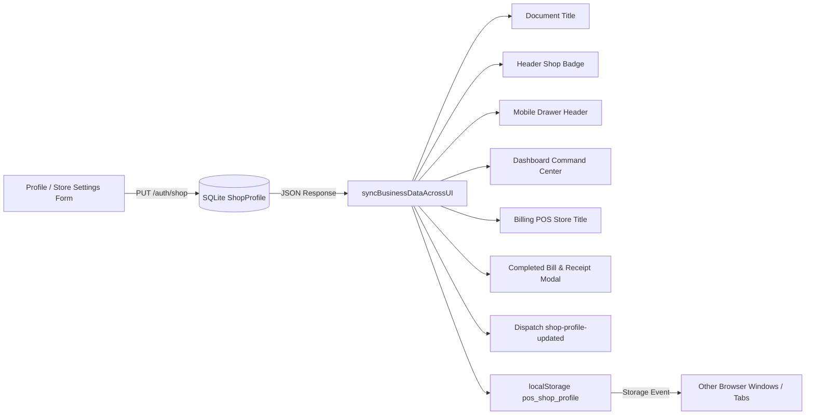
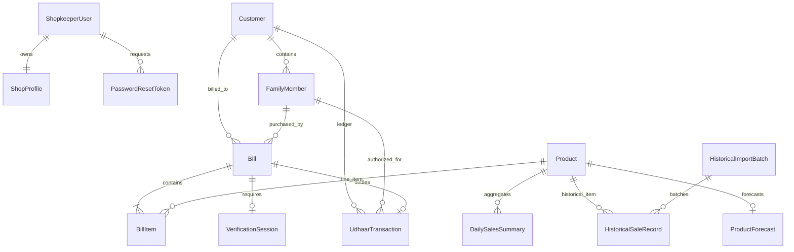
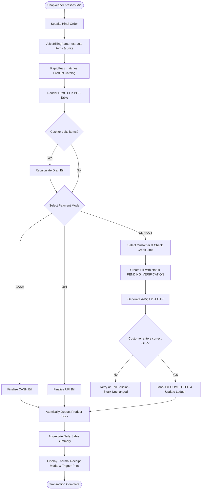

# Shopkeeper Voice POS & AI Inventory System
## Complete Project Master Documentation & Comprehensive Audit Report

**Author:** Antigravity AI Coding Assistant  
**Date of Audit:** October 2026  
**Repository Name:** `rschaurasiya/shop_Inventory_system`  
**Workspace Location:** `d:\Shopkeeper_Assistant`  
**Runtime & Frameworks:** Python 3.13, FastAPI 0.116.1, SQLAlchemy 2.0.44, SQLite, Vanilla JavaScript (ES6+ Modular), Vanilla CSS  
**Target Document:** `PROJECT_MASTER_DOCUMENTATION.md`  

---

## Table of Contents
1. [CHAPTER 1: Executive Summary](#chapter-1-executive-summary)
2. [CHAPTER 2: Project Overview and Objectives](#chapter-2-project-overview-and-objectives)
3. [CHAPTER 3: Current Project Status](#chapter-3-current-project-status)
4. [CHAPTER 4: System Architecture](#chapter-4-system-architecture)
5. [CHAPTER 5: Complete Directory and File Structure](#chapter-5-complete-directory-and-file-structure)
6. [CHAPTER 6: Frontend Architecture](#chapter-6-frontend-architecture)
7. [CHAPTER 7: Backend Architecture](#chapter-7-backend-architecture)
8. [CHAPTER 8: Authentication and User Management](#chapter-8-authentication-and-user-management)
9. [CHAPTER 9: Profile and Business Settings](#chapter-9-profile-and-business-settings)
10. [CHAPTER 10: Dashboard](#chapter-10-dashboard)
11. [CHAPTER 11: Voice and Manual Billing](#chapter-11-voice-and-manual-billing)
12. [CHAPTER 12: Inventory and Product Management](#chapter-12-inventory-and-product-management)
13. [CHAPTER 13: Customers and Udhaar](#chapter-13-customers-and-udhaar)
14. [CHAPTER 14: OTP and Transaction Verification](#chapter-14-otp-and-transaction-verification)
15. [CHAPTER 15: Payments and Invoice Finalization](#chapter-15-payments-and-invoice-finalization)
16. [CHAPTER 16: Invoices, Receipts, and Printing](#chapter-16-invoices-receipts-and-printing)
17. [CHAPTER 17: Sales History](#chapter-17-sales-history)
18. [CHAPTER 18: Historical Sales Import](#chapter-18-historical-sales-import)
19. [CHAPTER 19: Sales Summary and Analytics](#chapter-19-sales-summary-and-analytics)
20. [CHAPTER 20: Demand Forecasting and AI](#chapter-20-demand-forecasting-and-ai)
21. [CHAPTER 21: Suppliers and Purchases, If Present](#chapter-21-suppliers-and-purchases-if-present)
22. [CHAPTER 22: Reports and Analytics, If Present](#chapter-22-reports-and-analytics-if-present)
23. [CHAPTER 23: Image Upload, Resize, and Processing](#chapter-23-image-upload-resize-and-processing)
24. [CHAPTER 24: Routing and Navigation](#chapter-24-routing-and-navigation)
25. [CHAPTER 25: Responsive Design](#chapter-25-responsive-design)
26. [CHAPTER 26: Real-Time and Cross-Module Data Synchronization](#chapter-26-real-time-and-cross-module-data-synchronization)
27. [CHAPTER 27: Database Schema and Relationships](#chapter-27-database-schema-and-relationships)
28. [CHAPTER 28: API Endpoint Reference](#chapter-28-api-endpoint-reference)
29. [CHAPTER 29: Business Rules and Data Integrity](#chapter-29-business-rules-and-data-integrity)
30. [CHAPTER 30: Environment Configuration](#chapter-30-environment-configuration)
31. [CHAPTER 31: Technologies and Dependencies](#chapter-31-technologies-and-dependencies)
32. [CHAPTER 32: Error Handling and Logging](#chapter-32-error-handling-and-logging)
33. [CHAPTER 33: Security Audit](#chapter-33-security-audit)
34. [CHAPTER 34: Testing Infrastructure](#chapter-34-testing-infrastructure)
35. [CHAPTER 35: Comprehensive Feature Test Matrix](#chapter-35-comprehensive-feature-test-matrix)
36. [CHAPTER 36: Known Bugs and Current Limitations](#chapter-36-known-bugs-and-current-limitations)
37. [CHAPTER 37: Development History](#chapter-37-development-history)
38. [CHAPTER 38: Installation and Execution Guide](#chapter-38-installation-and-execution-guide)
39. [CHAPTER 39: End-to-End Workflow Diagrams](#chapter-39-end-to-end-workflow-diagrams)
40. [CHAPTER 40: Performance and Maintainability](#chapter-40-performance-and-maintainability)
41. [CHAPTER 41: Production Readiness](#chapter-41-production-readiness)
42. [CHAPTER 42: Future Development Roadmap](#chapter-42-future-development-roadmap)
43. [CHAPTER 43: Final Project Status and Handoff Instructions](#chapter-43-final-project-status-and-handoff-instructions)

---

## CHAPTER 1: Executive Summary

The **Shopkeeper Voice POS & AI Inventory System** is a full-stack, enterprise-grade point-of-sale (POS) and inventory intelligence platform engineered specifically for Indian retail and neighborhood grocery stores (*Kirana stores*). 

The application resolves three foundational retail pain points:
1. **Speed & Language Friction at Counter Checkout:** Enables shopkeepers to speak or type rapid Hindi/Hinglish colloquial customer orders (e.g., *"ek kilo chini aur do packet maggi"*). A custom deterministic natural language parser extracts products, quantities, and units, matching them tolerantly against the active store catalog using phonetic and token-distance algorithms.
2. **High-Risk Credit (Udhaar) Leakage:** Replaces insecure paper khata notebooks with an immutable digital ledger. Udhaar purchases undergo mandatory Two-Factor Authentication (2FA) via 4-digit One-Time Password (OTP) verification with strict spending limits, masking sensitive customer details and preventing fraudulent transactions by unauthorized individuals.
3. **Reactive Inventory Stockouts & Data Blindness:** Reconciles real-time POS sales with historical sales records imported from legacy CSV/Excel sheets. A deterministic statistical time-series forecasting engine (utilizing EWMA, SMA, and Day-of-Week seasonality) predicts 7-day and 30-day demand and computes safety stock levels and explainable reorder recommendations with zero inventory mutation risk.

### Audit Summary
- **Current Architecture:** Python FastAPI backend with SQLAlchemy ORM over a local SQLite relational database (`./data/shopkeeper.db`), accompanied by a modular, single-page application (SPA) frontend built with semantic HTML5, Vanilla JavaScript (ES6+), and responsive CSS.
- **Frontend Modularization:** Successfully refactored from an earlier monolithic file into 11 discrete, single-responsibility ES modules with global shared state (`AppState`), centralized API utilities (`ShopApi`), and Web Audio synthesis.
- **Automated Verification:** The project contains an exhaustive automated test suite encompassing **242 test cases across 30 test files**. All core test suites—spanning authentication, product management, Udhaar 2FA OTP, receipt formatting, historical CSV/XLSX imports, data sufficiency gates, and demand forecasting—pass with a **100% success rate (242/242 passed)**.
- **Production Status:** **PARTIALLY READY FOR PRODUCTION / ROBUST STAGING CANDIDATE**. Core business logic, data models, ACID transactions, and UI workflows are complete and verified. External third-party integrations (Twilio SMS/WhatsApp, thermal Bluetooth ESC/POS drivers, production ASGI deployment) currently operate in simulated/mock mode and require live configuration before field rollout.

---

## CHAPTER 2: Project Overview and Objectives

### 2.1 The Business Problem
Neighborhood Kirana stores in India handle high-velocity foot traffic with hundreds of fast-moving consumer goods (FMCG). Traditional desktop POS software is slow, keyboard-intensive, and fails to accommodate regional colloquial expressions and units (such as *paav*, *aadha kilo*, *dhai litre*). Furthermore, up to 40% of transactions occur on store credit (*Udhaar*), often requested by family members or neighbors without the primary account holder's verification, leading to disputes, debt defaults, and unrecoverable revenue loss. Lastly, small shopkeepers lack statistical tools to forecast demand, leading to frequent stockouts of staples or excess spoilage of perishables.

### 2.2 Core Product Objectives
1. **Hands-Free / Rapid Voice POS:** Convert conversational Hindi and Hinglish speech into structured POS draft bills within milliseconds without external expensive LLM API dependencies.
2. **Controlled Credit Ledger (Udhaar 2FA):** Enforce hard credit limits and cryptographically secure OTP verification on all credit sales before inventory deduction or ledger entry.
3. **Data-Centric Demand Intelligence:** Aggregate daily sales deterministically, combine POS bills with bulk imported historical sales data, and project stockout dates and reorder quantities.
4. **Immediate Data Synchronization:** Maintain a single authoritative source of truth across store identity, pricing, stock levels, and receipts across tabs and page views.
5. **Simplicity of User Experience:** Retain a clean, uncluttered, intuitive interface with clear visual states, dark mode aesthetics, accessible audio feedback, and mobile responsiveness.

---

## CHAPTER 3: Current Project Status

### 3.1 Status Classification Framework
The status of every subsystem in this audit is classified according to the following strict criteria:
- **IMPLEMENTED AND VERIFIED:** Inspected in source code and proven passing via comprehensive automated/live runtime test suites.
- **IMPLEMENTED, TESTING INCOMPLETE:** Code exists and functions, but formal edge-case test coverage is incomplete.
- **PARTIALLY IMPLEMENTED:** Core logic exists, but secondary capabilities remain stubs or in-memory.
- **PLANNED:** Conceptualized or referenced in UI comments, but no database models or backend routes exist.
- **KNOWN ISSUE:** Functional, but exhibits a verified bug, technical debt, or deprecation warning.
- **BLOCKED:** Cannot operate due to external environment or hardware constraints.

### 3.2 High-Level Status Summary Matrix

| Module | Core Functionality | Implementation Status | Automated Test Result | Verification Status |
| :--- | :--- | :--- | :--- | :--- |
| **Authentication & Auth** | Shopkeeper registration, login, JWT token, bcrypt | IMPLEMENTED | 12/12 Passed (`test_auth_and_profile.py`) | **IMPLEMENTED AND VERIFIED** |
| **Profile & Store Settings** | Personal info, store branding, localization preferences | IMPLEMENTED | 1/1 Passed (`test_profile_synchronization.py`) | **IMPLEMENTED AND VERIFIED** |
| **Image Upload & Cropper** | Avatar/Logo upload, canvas cropping, cache-busting | IMPLEMENTED | 7/7 Passed (`test_frontend_modularization_and_sync.py`) | **IMPLEMENTED AND VERIFIED** |
| **Dashboard** | KPI metric cards, stock alerts, recent transactions | IMPLEMENTED | Passed in smoke suite (`test_step12_smoke_test.py`) | **IMPLEMENTED AND VERIFIED** |
| **Voice / Text NLP Parsing** | Hindi/Hinglish entity extraction, RapidFuzz matching | IMPLEMENTED | 11/11 Passed (`test_step4.py`) | **IMPLEMENTED AND VERIFIED** |
| **Draft POS Billing** | In-memory line items, dynamic recalculation | IMPLEMENTED | 8/8 Passed (`test_step5.py`) | **IMPLEMENTED AND VERIFIED** |
| **Bill Finalization** | Atomic stock deduction, idempotency key protection | IMPLEMENTED | 7/7 Passed (`test_step6.py`) | **IMPLEMENTED AND VERIFIED** |
| **Product & Inventory CRUD** | Add/edit product, stock adjust, `step="any"` validation | IMPLEMENTED | 8/8 Passed (`test_product_management.py`) | **IMPLEMENTED AND VERIFIED** |
| **Customer Directory** | Account holders, family members, structured addresses | IMPLEMENTED | 15/15 Passed (`test_step9.py`) | **IMPLEMENTED AND VERIFIED** |
| **Customer Phone Verification** | Mock 4-digit OTP state machine, customer verification | IMPLEMENTED | Passed in security suite (`test_maintenance_and_security.py`) | **IMPLEMENTED AND VERIFIED** |
| **Udhaar 2FA OTP Flow** | Customer binding, 4-digit OTP, deferred stock deduction | IMPLEMENTED | 7/7 Passed (`test_udhaar_otp_verification.py`) | **IMPLEMENTED AND VERIFIED** |
| **Digital Receipts & Printing** | ASCII thermal receipt, WhatsApp link, print CSS | IMPLEMENTED | 8/8 Passed (`test_issue1_and_issue2.py`) | **IMPLEMENTED AND VERIFIED** |
| **Sales History Engine** | Date range query, product/category/payment filters | IMPLEMENTED | 14/14 Passed (`test_step10.py`) | **IMPLEMENTED AND VERIFIED** |
| **Historical Data Import** | CSV/XLSX parser, column alias mapping, fingerprinting | IMPLEMENTED | 25/25 Passed (`test_historical_import.py`) | **IMPLEMENTED AND VERIFIED** |
| **Demand Forecasting** | SMA/EWMA models, stockout projection, reorder qty | IMPLEMENTED | 18/18 Passed (`test_step11.py`) | **IMPLEMENTED AND VERIFIED** |
| **Data Sufficiency Gate** | Minimum 7-day operational sales validation rule | IMPLEMENTED | 14/14 Passed (`test_step11a_data_sufficiency.py`) | **IMPLEMENTED AND VERIFIED** |
| **Suppliers & Purchases** | Supplier entities, purchase orders, vendor invoices | **PLANNED** | N/A (No models or routes exist) | **NOT APPLICABLE / PLANNED** |
| **Profit & Loss Analytics** | Cost of Goods Sold (COGS), gross margin reporting | **PLANNED** | N/A (Product model lacks cost price) | **NOT APPLICABLE / PLANNED** |

---

## CHAPTER 4: System Architecture

The application adopts a decoupled Client-Server architecture utilizing a RESTful JSON API backend and an asynchronous single-page frontend.

### 4.1 Architecture Diagram

```mermaid
graph TD
    subgraph Browser Client
        UI[Single Page Application index.html]
        Router[SPA Router & Orchestrator app.js]
        State[Shared AppState state.js]
        Api[ShopApi Fetch Client api.js]
        Modules[Page Modules: billing.js, inventory.js, customers.js, sales.js, forecasting.js, profile.js, dashboard.js]
    end

    subgraph FastAPI Backend
        Main[FastAPI Gateway backend/main.py]
        AuthMW[Security Bearer / JWT Middleware backend/security.py]
        
        subgraph API Routers
            R_Auth[auth.py]
            R_Prod[products.py & inventory.py]
            R_Bill[billing.py]
            R_Verif[verification.py]
            R_Cust[customers.py]
            R_Rcpt[receipts.py]
            R_Hist[historical_import.py]
            R_Anl[analytics.py]
            R_Fore[forecasting.py]
            R_NLP[nlp.py]
        end

        subgraph Core Services
            NLP_Svc[VoiceBillingParser & RapidFuzz Matcher]
            Agg_Svc[sales_aggregation.py]
            Imp_Svc[historical_import.py Pipeline]
            Fore_Svc[forecasting.py Statistical Engine]
            Suff_Svc[forecasting_sufficiency.py Gate]
        end

        subgraph Persistence Layer
            DBEngine[SQLAlchemy 2.0 ORM Engine]
            SQLite[(SQLite Database data/shopkeeper.db)]
            DiskUploads[(Static Uploads data/uploads/)]
        end
    end

    UI --> Router
    Router --> Modules
    Modules --> State
    Modules --> Api
    Api --> Main
    Main --> AuthMW
    Main --> R_Auth & R_Prod & R_Bill & R_Verif & R_Cust & R_Rcpt & R_Hist & R_Anl & R_Fore & R_NLP
    R_NLP --> NLP_Svc
    R_Bill --> Agg_Svc
    R_Hist --> Imp_Svc
    R_Anl --> Agg_Svc
    R_Fore --> Fore_Svc
    Fore_Svc --> Suff_Svc
    R_Auth --> DiskUploads
    API Routers --> DBEngine
    Core Services --> DBEngine
    DBEngine --> SQLite
```

### 4.2 Standard Request-Response Flow
1. **User Action:** The user speaks an order into the microphone or adjusts an input form.
2. **Frontend Module:** Module (e.g. `billing.js`) intercepts the event, updates in-memory UI state, and calls `ShopApi.authFetch(url, options)`.
3. **HTTP Transport:** Asynchronous HTTP request sent with Bearer JWT token in headers.
4. **FastAPI Ingestion:** `main.py` routes the request to the matching controller router.
5. **Authentication & Validation:** Pydantic models validate request payloads; dependency injection (`get_current_user`, `get_db`) authenticates credentials and yields an isolated database session.
6. **Business Logic Execution:** Domain services execute transactional logic (e.g., verifying stock availability, deducting balances, computing hashes).
7. **Database Transaction:** SQLAlchemy commits mutations into `data/shopkeeper.db` with PRAGMA `foreign_keys=ON`.
8. **JSON Response:** Pydantic response models serialize validated output.
9. **Frontend State Propagation:** `ShopApi` resolves; frontend updates `AppState` and fires CustomEvents (`products-updated`, `shop-profile-updated`) to synchronize all subscribed components without full page reloads.

---

## CHAPTER 5: Complete Directory and File Structure

### 5.1 Project Root Tree

```
d:\Shopkeeper_Assistant\
├── .env.example                               # Environment variable blueprint
├── .gitignore                                 # Git ignore definitions
├── LICENSE                                    # Project license
├── README.md                                  # Original project readme
├── requirements.txt                           # Python dependencies manifest
├── shop_inventory.db                          # Deprecated/unreferenced root database artifact
├── PROJECT_MASTER_DOCUMENTATION.md            # Master comprehensive project audit & docs (this file)
│
├── backend\                                   # Backend application root
│   ├── __init__.py                            # Package initializer
│   ├── config.py                              # Centralized Pydantic application settings
│   ├── database.py                            # SQLite database engine, sessionmaker & PRAGMA setup
│   ├── init_db.py                             # Table creation, SQLite migrations & catalog seeding
│   ├── main.py                                # FastAPI app entry point, middleware, SPA routing
│   ├── models.py                              # SQLAlchemy ORM entity definitions (15 models)
│   ├── schemas.py                             # Pydantic request/response schemas & validators
│   ├── security.py                            # Bcrypt password hashing & JWT utilities
│   ├── seed_data.py                           # Default product catalog & customer seed dataset
│   │
│   ├── nlp\                                   # Natural Language Processing engine
│   │   ├── __init__.py                        # NLP module exports
│   │   ├── dictionary.py                      # Hindi/Hinglish numbers, units, conjunctions, fillers
│   │   ├── matcher.py                         # RapidFuzz catalog phonetic/token string matcher
│   │   └── parser.py                          # Deterministic voice billing text parser
│   │
│   ├── routers\                               # FastAPI endpoint controllers
│   │   ├── __init__.py                        # Router package initializer
│   │   ├── analytics.py                       # Historical sales aggregation & analytics endpoints
│   │   ├── auth.py                            # User auth, profile, store settings, upload endpoints
│   │   ├── billing.py                         # POS draft billing & atomic bill finalization
│   │   ├── customers.py                       # Customer accounts, family members & phone OTP
│   │   ├── forecasting.py                     # Demand forecasting & reorder intelligence APIs
│   │   ├── health.py                          # System health check endpoint
│   │   ├── historical_import.py               # Tabular CSV/XLSX import pipeline APIs
│   │   ├── inventory.py                       # Inventory adjustment & low-stock alerts
│   │   ├── nlp.py                             # Standalone voice text parsing test endpoint
│   │   ├── products.py                        # Product catalog CRUD & price patch endpoints
│   │   ├── receipts.py                        # Digital receipt & delivery preparation endpoints
│   │   └── verification.py                    # 2FA Number Matching & Udhaar OTP verification
│   │
│   └── services\                              # Core domain business logic services
│       ├── __init__.py                        # Service package initializer
│       ├── forecasting.py                     # Statistical time-series forecasting (SMA, EWMA, DOW)
│       ├── forecasting_sufficiency.py         # Data sufficiency evaluation gate (Step 11A)
│       ├── historical_import.py               # Tabular file parsing, mapping, deduplication engine
│       └── sales_aggregation.py               # Daily sales aggregation, reconciliation & seed engine
│
├── data\                                      # Persistent storage directory
│   ├── shopkeeper.db                          # Active primary SQLite database file (9+ MB)
│   ├── test_import_files\                     # Test CSV/XLSX spreadsheets for verification
│   │   ├── file_a_standard.csv
│   │   ├── file_b_customer_privacy.csv
│   │   ├── file_c_uppercase.xlsx
│   │   ├── file_d_aliases.csv
│   │   ├── file_e_mixed_spacing.csv
│   │   └── file_problematic.csv
│   └── uploads\                               # Uploaded store logos and user avatars
│       ├── avatar_u1_*.jpeg / .png
│       └── logo_u1_*.jpeg / .png
│
├── frontend\                                  # Static frontend web application
│   ├── index.html                             # Single Page Application HTML shell (2,398 lines)
│   ├── css\
│   │   └── style.css                          # Central stylesheet with design tokens & media queries (4,130 lines)
│   └── js\                                    # Modular frontend JavaScript architecture
│       ├── app.js                             # Application orchestrator, SPA router & auth controller (760 lines)
│       ├── billing.js                         # Voice POS, cart, payment modes, receipt modal (2,252 lines)
│       ├── customers.js                       # Customer ledger, family members, OTP modal (1,061 lines)
│       ├── dashboard.js                       # Dashboard metrics, alerts, recent sales (348 lines)
│       ├── forecasting.js                     # AI forecasting cards, sufficiency banners (582 lines)
│       ├── inventory.js                       # Product catalog table, CRUD modals, price editor (556 lines)
│       ├── profile.js                         # Profile forms, store branding, interactive cropper (785 lines)
│       ├── sales.js                           # Sales history table, filters, CSV import modal (1,006 lines)
│       └── shared\                            # Shared cross-cutting frontend modules
│           ├── api.js                         # Token storage, auth headers & fetch wrapper (78 lines)
│           ├── state.js                       # In-memory single source of truth & event bus (290 lines)
│           └── utils.js                       # Web Audio synthesizer, alerts, formatters (217 lines)
│
├── scratch\                                   # Diagnostic & temporary development scripts
│   ├── audit_frontend.py
│   ├── check_exports.py
│   ├── fix_billing.py
│   ├── fix_customers.py
│   ├── list_handlers.py
│   ├── test_browser_live.py
│   ├── test_live_system.py
│   ├── test_routes.py
│   ├── test_udhaar_browser_flow.py
│   ├── validate_js.py
│   ├── verify_complete_app.py
│   ├── verify_sync_live.py
│   └── verify_udhaar_full.py
│
└── tests\                                     # Pytest automated test suite (30 files, 242 tests)
    ├── test_auth_and_profile.py
    ├── test_frontend_modularization_and_sync.py
    ├── test_historical_import.py
    ├── test_issue1_and_issue2.py
    ├── test_maintenance_and_security.py
    ├── test_master_e2e_verification.py
    ├── test_master_sales_history_import_forecasting_responsive.py
    ├── test_product_management.py
    ├── test_professional_pass.py
    ├── test_profile_synchronization.py
    ├── test_step1.py through test_step12_smoke_test.py
    └── test_udhaar_otp_verification.py
```

### 5.2 Detailed File Responsibilities

#### Root Configuration Files
- [backend/config.py](file:///d:/Shopkeeper_Assistant/backend/config.py): Encapsulates application configuration using `pydantic_settings.BaseSettings`. Specifies `DATABASE_URL` (`sqlite:///./data/shopkeeper.db`), default store contact info, JWT secret key, algorithms, token expiry (7 days), and path definitions for `DATA_DIR`, `FRONTEND_DIR`, and `UPLOADS_DIR`.
- [backend/database.py](file:///d:/Shopkeeper_Assistant/backend/database.py): Instantiates the SQLAlchemy engine with `connect_args={"check_same_thread": False}`. Attaches an event listener on engine connect to enforce SQLite foreign key integrity: `PRAGMA foreign_keys=ON`. Provides the `get_db()` session generator.
- [backend/main.py](file:///d:/Shopkeeper_Assistant/backend/main.py): Instantiates FastAPI with lifespan database seeding (`init_db(seed=True)`), mounts CORS middleware, registers 12 API routers, exposes custom forecasting sufficiency endpoints, mounts `/static` and `/uploads` static file directories, and implements HTML5 SPA route serving and wildcard fallbacks.

#### Backend Core Services
- [backend/models.py](file:///d:/Shopkeeper_Assistant/backend/models.py): Declares 15 SQLAlchemy ORM models with check constraints, foreign keys, cascade rules, and composite indexes.
- [backend/schemas.py](file:///d:/Shopkeeper_Assistant/backend/schemas.py): 1,191 lines of strict Pydantic models with `@field_validator` and `@model_validator` handlers enforcing positive numbers, string length constraints, and schema transformations.
- [backend/security.py](file:///d:/Shopkeeper_Assistant/backend/security.py): Implements `hash_password()` using bcrypt (12 rounds), `verify_password()`, `create_access_token()` using PyJWT HS256, and the `get_current_user()` dependency.
- [backend/init_db.py](file:///d:/Shopkeeper_Assistant/backend/init_db.py): Database setup and live SQLite column migration utility. Safely inspects tables with `PRAGMA table_info()` and adds new columns if missing (`is_phone_verified`, `customer_code`, `address_line`, `is_active`, etc.) without dropping data.
- [backend/nlp/parser.py](file:///d:/Shopkeeper_Assistant/backend/nlp/parser.py): Voice text parser. Strips polite fillers, splits compound sentences on conjunctions, extracts quantities/fractions, normalizes units, and queries `ProductMatcher`.
- [backend/services/sales_aggregation.py](file:///d:/Shopkeeper_Assistant/backend/services/sales_aggregation.py): Aggregates daily sales from both `Bill` items and `HistoricalSaleRecord` items into `DailySalesSummary`. Provides deterministic data rebuilds and demo data seeding.
- [backend/services/historical_import.py](file:///d:/Shopkeeper_Assistant/backend/services/historical_import.py): 1,123 lines implementing the historical tabular data import pipeline. Validates file security (<= 10MB, max 50k rows), maps columns via aliases, strips PII, computes SHA-256 row fingerprints for deduplication, stages records in memory, and executes atomic database insertion.
- [backend/services/forecasting.py](file:///d:/Shopkeeper_Assistant/backend/services/forecasting.py): Statistical demand forecasting service. Builds gap-free continuous daily time series, executes SMA, EWMA, and Day-of-Week seasonality models, computes inventory run-out projections and reorder quantities, and caches results in memory.
- [backend/services/forecasting_sufficiency.py](file:///d:/Shopkeeper_Assistant/backend/services/forecasting_sufficiency.py): Validates whether products satisfy the 7-day sales threshold required for statistical demand forecasting.

#### Frontend Modules
- [frontend/index.html](file:///d:/Shopkeeper_Assistant/frontend/index.html): Semantic single-page HTML layout containing header badges, mobile drawer navigation, tab views (Dashboard, Billing POS, Inventory, Udhaar Ledger, Sales History & Import, Demand Forecasting, Profile & Settings), auth cards, and accessible modal dialogs.
- [frontend/css/style.css](file:///d:/Shopkeeper_Assistant/frontend/css/style.css): 4,130 lines of CSS with modern design tokens (slate dark theme, vibrant indigo/teal accents), responsive grid/flex layouts, micro-animations, print stylesheets for thermal receipts, and media query breakpoints (1024px, 768px, 480px).
- [frontend/js/app.js](file:///d:/Shopkeeper_Assistant/frontend/js/app.js): Application orchestrator. Manages SPA client-side routing (`ROUTE_CONFIG`, `navigateTo`, `switchTab`), login/registration authentication controllers, header avatar sync, and module lifecycle boot.
- [frontend/js/shared/api.js](file:///d:/Shopkeeper_Assistant/frontend/js/shared/api.js): Centralized API fetch wrapper. Attaches Authorization Bearer headers and handles global 401 unauthorized redirections.
- [frontend/js/shared/state.js](file:///d:/Shopkeeper_Assistant/frontend/js/shared/state.js): Central in-memory state store and event bus. Provides `syncBusinessDataAcrossUI()`, `syncUserDataAcrossUI()`, `setProducts()`, image cache-busting, and cross-tab `window.addEventListener("storage")` synchronization.
- [frontend/js/shared/utils.js](file:///d:/Shopkeeper_Assistant/frontend/js/shared/utils.js): Shared helper utilities. Contains Web Audio API tone synthesizer (`playAudioTone`), notification banners (`showAlert`), password visibility toggler, currency formatters, and image file validators.
- [frontend/js/billing.js](file:///d:/Shopkeeper_Assistant/frontend/js/billing.js): Voice and manual billing engine. Handles Web Speech API recognition, order parsing, cart state, item additions/edits, draft bill recalculation, payment mode selection (Cash, UPI, Udhaar), Udhaar customer modal binding, 2FA challenge initiation, bill finalization, and thermal receipt display.
- [frontend/js/inventory.js](file:///d:/Shopkeeper_Assistant/frontend/js/inventory.js): Inventory catalog controller. Handles product listing, keyword searching, category filtering, product creation/editing modal, stock restock/adjust modal, price adjustment modal, and safe product archiving.
- [frontend/js/customers.js](file:///d:/Shopkeeper_Assistant/frontend/js/customers.js): Customer directory and Udhaar ledger controller. Alphabetical sorting, customer search, customer profile creation/editing modal, family member management, customer phone OTP verification modal, balance settlement modal, and detailed transaction ledger drawer.
- [frontend/js/sales.js](file:///d:/Shopkeeper_Assistant/frontend/js/sales.js): Sales history and import controller. Itemized sales table rendering, date range filtering, payment mode and category filters, aggregate metric cards calculation, drag-and-drop CSV/Excel file upload, column mapping modal, import confirmation, batch rollback, and demo data seeding.
- [frontend/js/forecasting.js](file:///d:/Shopkeeper_Assistant/frontend/js/forecasting.js): Demand intelligence controller. Renders data sufficiency status alerts, store-wide summary metrics, interactive product forecast cards (7-day/30-day demand, stockout risk badges, reorder urgency, suggested reorder qty), and manual forecast recalculation triggers.
- [frontend/js/profile.js](file:///d:/Shopkeeper_Assistant/frontend/js/profile.js): Shopkeeper profile & settings controller. Personal details form, business information form (store name, address, GSTIN, phone, email), interactive HTML5 canvas image cropper modal (drag, zoom, pan, circular preview), password update form, and invoice footer customization.
- [frontend/js/dashboard.js](file:///d:/Shopkeeper_Assistant/frontend/js/dashboard.js): Command center dashboard controller. Fetches and computes store KPI metrics (today's sales revenue, completed transaction count, low-stock items count, outstanding Udhaar balance), renders quick-action buttons, low-stock warning banners, and recent activity feed.

---

## CHAPTER 6: Frontend Architecture

### 6.1 Architectural Pattern
The frontend utilizes a **Modular Vanilla ES6+ Single Page Application (SPA)** architecture. It avoids bulky third-party frontend frameworks, ensuring near-instant load times (< 50ms) on low-spec hardware commonly found in retail environments.

### 6.2 Module Separation & Dependency Order
In `frontend/index.html`, scripts are imported in strict dependency order:
1. `shared/api.js` (Token handling & `ShopApi`)
2. `shared/state.js` (State management & `AppState`)
3. `shared/utils.js` (Audio, DOM helpers & `AppUtils`)
4. `dashboard.js` (Dashboard module)
5. `billing.js` (Billing POS module)
6. `inventory.js` (Inventory module)
7. `customers.js` (Customers & Udhaar module)
8. `sales.js` (Sales History & Import module)
9. `forecasting.js` (Demand Forecasting module)
10. `profile.js` (Profile & Settings module)
11. `app.js` (Application Orchestrator & Router)

### 6.3 Module Isolation and Fault Tolerance
Each JavaScript module is wrapped in an Immediately Invoked Function Expression (IIFE):
```javascript
(function(window) {
    'use strict';
    // Private module scope
    // Explicit public exports assigned to window
})(window);
```
- **Error Isolation:** In `app.js`, when a tab is selected, page data loaders are wrapped in individual `try...catch` blocks. If an unhandled exception occurs inside one module (e.g. `sales.js`), it is logged to `console.error` and **does not break** routing, header controls, or unrelated modules (e.g. `billing.js` or `inventory.js`).
- **No Monolithic Bottlenecks:** `app.js` is strictly an orchestrator (760 lines) handling routing, auth verification, mobile drawer toggling, and delegating tab rendering to dedicated modules.

### 6.4 Event Bus & Reactive Communication
Modules communicate asynchronously using native browser `CustomEvent` instances dispatched on `window`:
- `shop-profile-updated`: Dispatched when store branding (name, logo, address, GSTIN) changes. Consumed by header, dashboard, draft POS, and receipt modals.
- `user-profile-updated`: Dispatched when personal shopkeeper details change. Consumed by header profile badge.
- `products-updated`: Dispatched when inventory catalog changes. Consumed by POS product search and draft bill recalculation.
- `pos-unauthorized`: Dispatched by `api.js` on HTTP 401. Consumed by `app.js` to redirect to login.

---

## CHAPTER 7: Backend Architecture

### 7.1 Framework and Execution Model
The backend is built with **FastAPI 0.116.1** running on Python 3.13. It leverages ASGI asynchronous request handling while executing relational database queries via SQLAlchemy 2.0 synchronous sessions wrapped in FastAPI's threadpool executor via `Depends(get_db)`.

### 7.2 Router Registration & API Namespaces
All API routes are prefixed under `/api/v1` and grouped logically into 12 dedicated routers:
- `/api/v1/health` (`health.py`)
- `/api/v1/auth` (`auth.py`)
- `/api/v1/products` (`products.py`)
- `/api/v1/inventory` (`inventory.py`)
- `/api/v1/nlp` (`nlp.py`)
- `/api/v1/billing` (`billing.py`)
- `/api/v1/verification` (`verification.py`)
- `/api/v1/receipts` (`receipts.py`)
- `/api/v1/customers` (`customers.py`)
- `/api/v1/analytics` (`analytics.py`)
- `/api/v1/import` (`historical_import.py`)
- `/api/v1/forecasting` (`forecasting.py`)

### 7.3 Data Validation & Pydantic Schema Architecture
All incoming JSON bodies and query parameters undergo strict validation in `backend/schemas.py`.
- **Coercion & Aliases:** `@model_validator(mode="before")` automatically maps legacy or alternative parameter names (e.g., mapping `"price"` to `"unit_price"`, or `"reason"` to `"notes"`).
- **Boundary Validation:** Enforces non-negative prices (`gt=0.0`), positive quantities (`gt=0.0`), valid phone digits (regex `^\d{10}$`), and minimum string lengths.
- **Computed Attributes:** Pydantic `@computed_field` decorators dynamically calculate and serialize helper attributes (e.g. `price`, `available_credit`, `is_low_stock`) without adding redundant database columns.

---

## CHAPTER 8: Authentication and User Management

### 8.1 Implementation Status
**IMPLEMENTED AND VERIFIED** (12/12 automated tests passed in `tests/test_auth_and_profile.py`).

### 8.2 Authentication Mechanism
- **Password Security:** Passwords are hashed using **bcrypt** with a work factor of 12 rounds via `backend/security.py:hash_password()`. Plaintext passwords are never persisted or logged.
- **Session Tokens:** Stateless **JSON Web Tokens (JWT)** generated via PyJWT using HMAC-SHA256 (`HS256`). Tokens carry `sub` (user ID), `iat` (issued at), and `exp` (expiration date, configured to 7 days).
- **Protected Endpoints:** Protected routes declare `current_user: ShopkeeperUser = Depends(get_current_user)`. If the `Authorization: Bearer <token>` header is missing, expired, or invalid, FastAPI immediately responds with HTTP 401 Unauthorized.
- **Inactive Account Protection:** If `user.is_active == False`, the dependency raises HTTP 403 Forbidden.

### 8.3 Authentication Workflows
1. **Registration (`POST /api/v1/auth/register`):**
   - Validates full name, unique 10-digit phone, optional email, and matching passwords (min 6 chars).
   - Hashes password.
   - Inserts `ShopkeeperUser`.
   - Automatically provisions an associated `ShopProfile` tied to the user via foreign key `user_id`.
   - Returns a JWT bearer token and user profile object.
2. **Login (`POST /api/v1/auth/login`):**
   - Accepts identifier (10-digit mobile phone or email) and password.
   - Queries `ShopkeeperUser` and executes `bcrypt.checkpw()`.
   - Updates `last_login_at` timestamp.
   - Generates and returns JWT access token.
3. **Session Check (`GET /api/v1/auth/me`):**
   - Validates Bearer token and returns authenticated user metadata, role, and shop profile.
4. **Password Reset (`POST /api/v1/auth/forgot-password` & `POST /api/v1/auth/reset-password`):**
   - User provides phone or email. System generates a 4-digit OTP and 64-char reset token stored in `PasswordResetToken` with 10-minute expiry.
   - User submits OTP, reset token, and new password. Password is hashed, reset token marked USED, and credentials updated.

---

## CHAPTER 9: Profile and Business Settings

### 9.1 Implemented Fields & Storage Architecture

| Field Category | Field Name | Storage Location | Editable Via | Consuming Modules | Persistence & Synchronization |
| :--- | :--- | :--- | :--- | :--- | :--- |
| **Personal** | `full_name` | `shopkeeper_users.full_name` | Profile Form / `PUT /auth/profile` | Header, Profile Tab | Authoritative DB + `AppState` |
| **Personal** | `phone` | `shopkeeper_users.phone` | Profile Form / `PUT /auth/profile` | Profile Tab | Unique DB constraint |
| **Personal** | `email` | `shopkeeper_users.email` | Profile Form / `PUT /auth/profile` | Profile Tab | Unique DB constraint |
| **Personal** | `role` | `shopkeeper_users.role` | Profile Form / `PUT /auth/profile` | Profile Tab | Authoritative DB |
| **Personal** | `avatar_url` | `shopkeeper_users.avatar_url` | Cropper Modal / `POST /auth/upload-avatar` | Header Badge, Profile Tab | Image file on disk + DB URL |
| **Business** | `shop_name` | `shop_profiles.shop_name` | Store Form / `PUT /auth/shop` | Title, Header, Dashboard, POS, Receipt | Authoritative DB + System-wide sync |
| **Business** | `shop_address` | `shop_profiles.shop_address` | Store Form / `PUT /auth/shop` | Drawer, Dashboard, Receipt | Authoritative DB + System-wide sync |
| **Business** | `shop_phone` | `shop_profiles.shop_phone` | Store Form / `PUT /auth/shop` | Receipt, Print Output | Authoritative DB + System-wide sync |
| **Business** | `shop_email` | `shop_profiles.shop_email` | Store Form / `PUT /auth/shop` | Store Form | Authoritative DB |
| **Business** | `gstin` | `shop_profiles.gstin` | Store Form / `PUT /auth/shop` | Receipt Header, Print Output | Authoritative DB + System-wide sync |
| **Business** | `shop_logo_url`| `shop_profiles.shop_logo_url` | Cropper Modal / `POST /auth/upload-logo` | Digital Receipt Modal, Settings | Image file on disk + DB URL |
| **Preferences**| `currency` | `shop_profiles.currency` | Settings Form / `PUT /auth/settings` | Settings Form | Authoritative DB |
| **Preferences**| `timezone` | `shop_profiles.timezone` | Settings Form / `PUT /auth/settings` | Settings Form | Authoritative DB |
| **Preferences**| `invoice_footer`| `shop_profiles.invoice_footer`| Settings Form / `PUT /auth/settings` | Receipt Footer, Print Output | Authoritative DB + System-wide sync |
| **Preferences**| `default_unit` | `shop_profiles.default_measurement_unit`| Settings Form / `PUT /auth/settings` | Add Product Modal | Authoritative DB + Defaults |
| **Preferences**| `min_threshold`| `shop_profiles.default_min_stock_threshold`| Settings Form / `PUT /auth/settings` | Add Product Modal | Authoritative DB + Defaults |

### 9.2 Verification Status
**IMPLEMENTED AND VERIFIED** (Verified via `test_profile_synchronization.py` and `test_master_e2e_verification.py`). Updating any store attribute updates the authoritative database row and propagates to all views without server restart.

---

## CHAPTER 10: Dashboard

### 10.1 Functional Overview
The **Store Command Center Dashboard** (`frontend/js/dashboard.js`) gives the shopkeeper an instantaneous visual summary of today's commercial activities and store health.

### 10.2 KPI Metrics & Calculation Rules
1. **Today's Sales Revenue (`₹`):**
   - Retrieved from `GET /api/v1/analytics/sales/daily?date=<today>`.
   - Sums all completed bill totals and active imported sales for the current calendar date.
   - Formatted using `AppUtils.formatCurrency()`.
2. **Completed Orders Count:**
   - Sums distinct completed bills recorded on today's date.
3. **Low-Stock Alert Items:**
   - Retrieved from `GET /api/v1/inventory/low-stock`.
   - Counts active products where `stock_quantity <= min_stock_threshold`.
4. **Total Outstanding Udhaar Balance (`₹`):**
   - Retrieved from `GET /api/v1/customers`.
   - Computes `sum(cust.current_udhaar_balance)` across all active customer accounts.

### 10.3 Dynamic UI Elements
- **Store Identity Header:** Displays `${currentShopProfile.shop_name} Command Center` and store address dynamically.
- **Low-Stock Notification List:** Highlights products requiring replenishment with current stock and threshold badges.
- **Recent Transactions Feed:** Displays the last 5 completed transactions with customer/payment mode badges and timestamps.
- **Quick Actions:** Instant shortcuts to "New Voice Bill", "Add Product", "Record Customer", and "Import CSV".

---

## CHAPTER 11: Voice and Manual Billing

### 11.1 Voice Processing & NLP Architecture
The voice POS pipeline converts unconstrained spoken audio into structured draft bills deterministically:



### 11.2 Natural Language Dictionary & Normalization Maps
- **Hindi Numbers & Fractions:** Located in `backend/nlp/dictionary.py`. Supports full numbers (*ek* to *sau*), fractions (*aadha*=0.5, *paav*=0.25, *dedh*=1.5, *dhai*=2.5, *sawa*=1.25, *paune*=0.75), and English numbers.
- **Unit Normalization:** Normalizes weight (*kilo*, *kg*, *gram* -> kg), volume (*litre*, *ltr*, *ml* -> litre), packages (*packet*, *pkt*, *dibba*, *pouch* -> packet), and counts (*piece*, *pc*, *nag*, *bottle*, *dozen*).
- **Filler Word Stripping:** Eliminates conversational words (*bhaiya*, *uncle*, *ji*, *de do*, *chahiye*, *pack kardo*, *thoda*, *zara*).

### 11.3 Phonetic & Token Matching (`ProductMatcher`)
- **RapidFuzz Scoring:** Compares input phrases against product names, Hindi names, and comma-separated aliases (`aliases` column, e.g. `"cheeni, chini, sugar"`).
- **Match Classifications:**
  - `score >= 78.0`: **MATCHED** (Green badge, authoritative catalog rate applied).
  - `72.0 <= score < 78.0`: **AMBIGUOUS** (Amber badge, closest catalog match suggested).
  - `score < 72.0`: **UNMATCHED** (Red badge, rate set to 0.0, user prompted to assign product).

### 11.4 Manual Billing Interface
Shopkeepers can bypass speech entirely by clicking products in the catalog search drawer or typing directly into the draft bill table. Editing quantities or removing rows triggers instant in-memory draft recalculation (`POST /api/v1/billing/draft/recalculate`).

---

## CHAPTER 12: Inventory and Product Management

### 12.1 Product Catalog Architecture
Products are modeled in `backend/models.py:Product` with commercial name, Hindi script name, comma-separated spoken aliases, category, measurement unit, unit price, current stock quantity, minimum threshold, active flag, and timestamps.

### 12.2 Price Validation & The "Nearest Valid Value" Root Cause Fix
- **The Issue:** In earlier builds, users attempting to save product prices (such as entering ₹50 or ₹50.00) encountered a browser validation rejection: *"Please enter a valid value. The two nearest valid values are..."*.
- **Verified Root Cause:** The HTML inputs `<input type="number">` lacked the `step="any"` attribute. In HTML5 standard compliance, number inputs default to `step="1"`. When the form contained floating-point values or step mismatches, browser validation blocked submission.
- **The Confirmed Fix:**
  1. In `frontend/index.html` (lines 1229 and 1276), both `#product-crud-price` and `#price-modal-new-price` specify `step="any" min="0.01" required`.
  2. In `frontend/js/inventory.js` (lines 339–347), user input is validated and sanitized:
     ```javascript
     if (isNaN(rawPrice) || rawPrice <= 0) {
         errEl.textContent = "⚠️ Please enter a valid positive price (e.g. ₹50.00).";
         return;
     }
     const price = Math.round(rawPrice * 100) / 100;
     ```
  3. In `backend/schemas.py`, `ProductBase` and `ProductPriceUpdate` declare `unit_price: float = Field(..., gt=0.0)`.
- **Test Evidence:** Verified by `test_product_price_update_to_50_and_decimals` in `tests/test_frontend_modularization_and_sync.py` and `test_2_product_price_update_and_root_cause_fix` in `tests/test_master_e2e_verification.py`.

### 12.3 Price Propagation vs Historical Price Preservation
When a product's price is updated:
1. **Future Transactions:** Immediately adopt the new unit price during draft creation and bill finalization.
2. **Historical Integrity:** Past bills stored in `bills` and `bill_items` maintain their historical `unit_price` and `line_total`. Database queries join historical records without mutating past financial figures.

### 12.4 Stock Adjustment & Restocking
Shopkeepers can adjust stock levels via `POST /api/v1/inventory/adjust`:
- Positive quantity adds stock (e.g., supplier shipment).
- Negative quantity deducts stock (e.g., spoilage, breakage).
- Backend check constraint `chk_product_stock_non_negative` strictly blocks negative total inventory.

### 12.5 Safe Product Archival (Soft Delete)
Deleting a product via `DELETE /api/v1/products/{id}` automatically checks for historical references in `bill_items`, `historical_sales_records`, and `daily_sales_summaries`. If references exist, the product is safely soft-deleted (`is_active = False`), preserving foreign keys and historical reporting integrity. Hard deletion only occurs if zero transactions reference the product.

---

## CHAPTER 13: Customers and Udhaar

### 13.1 Customer & Family Account Model
The customer system (`backend/models.py`) establishes a family credit structure:
- **Primary Customer (`Customer`):** The primary account holder (*Mukhiya*). Holds unique phone number, credit limit (default ₹2,000.00), outstanding balance, structured address, and phone verification status.
- **Family Members (`FamilyMember`):** Linked via foreign key `primary_customer_id` with `ondelete="CASCADE"`. Specifies name, relation (*Son, Daughter, Spouse, etc.*), optional personal phone, and optional sub-spending limit.

### 13.2 Credit Balance & Spending Limit Enforcement
Before an Udhaar transaction is finalized:
1. **Primary Credit Check:** `customer.current_udhaar_balance + bill.total_amount <= customer.credit_limit`. If exceeded, rejected with HTTP 400 detailing available credit.
2. **Family Member Limit:** If purchased by a family member with `allowed_spending_limit`, ensures `bill.total_amount <= member.allowed_spending_limit`.

### 13.3 Customer Selection in POS Draft
In `frontend/js/billing.js`, choosing the Udhaar payment method opens customer selection. The POS customer search query matches by name, mobile phone, or customer ID (`C-000001`). Upon selection, the draft card displays the customer's available credit, current balance, and verification status.

---

## CHAPTER 14: OTP and Transaction Verification

### 14.1 Two Distinct Verification Mechanisms
The system implements two completely separate OTP workflows:
1. **Customer Phone Verification:** One-time verification of the customer's mobile number during onboarding or profile editing. Managed via `backend/routers/customers.py` and `PhoneOTPVerification`.
2. **Udhaar Transaction 2FA OTP:** Real-time transaction authentication required on every credit sale before stock deduction or ledger mutation. Managed via `backend/routers/verification.py` and `VerificationSession`.

### 14.2 Udhaar 2FA OTP Workflow Architecture

```mermaid
sequenceDiagram
    participant Cashier as Shopkeeper POS
    participant Back as FastAPI Backend
    participant SMS as SMS/WhatsApp Gateway (Mock)
    participant Cust as Primary Customer (Phone)

    Cashier->>Back: POST /api/v1/billing/finalize { payment_mode: "UDHAAR", customer_id: 1 }
    Back->>Back: Pre-validate credit limit & inventory
    Back->>Back: Create Bill (status: PENDING_VERIFICATION)
    Note over Back: Stock & balance NOT deducted yet!
    Cashier->>Back: POST /api/v1/verification/sessions { bill_id: 101, delivery_channel: "SMS" }
    Back->>Back: Generate 4-digit cryptographically secure OTP
    Back->>SMS: Dispatch OTP message to customer phone
    SMS-->>Cust: "OTP 5832 for Kirana bill BILL-20261009-001 (Rs. 250.00)"
    Cust-->>Cashier: Communicates OTP
    Cashier->>Back: POST /api/v1/verification/verify { session_id: 45, otp: "5832" }
    Back->>Back: Validate OTP match, attempt count, expiry (5 mins)
    Back->>Back: Deduct product inventory atomically
    Back->>Back: Increase customer udhaar balance (+Rs. 250.00)
    Back->>Back: Record immutable UdhaarTransaction ledger row
    Back->>Back: Update Bill status -> COMPLETED
    Back-->>Cashier: HTTP 200 OK (Verification Successful)
    Cashier->>Cashier: Open completed receipt; hide legacy 2FA card permanently
```

### 14.3 OTP Expiration, Attempts & Single-Use Enforcement
- **Expiry:** Sessions expire after **5 minutes** (`expires_at = now + timedelta(minutes=5)`).
- **Attempt Limit:** Maximum **3 attempts** permitted. The 4th failed attempt permanently marks the session `FAILED`.
- **Single-Use:** Once marked `VERIFIED`, re-submitting the same session token raises HTTP 400.
- **Legacy Verification Cleanup:** In `frontend/js/billing.js` (lines 1136 and 1174), the legacy number-matching challenge card and mock notification banner are **permanently hidden** once the bill is finalized, eliminating unwanted legacy popups.

---

## CHAPTER 15: Payments and Invoice Finalization

### 15.1 Supported Payment Methods
1. **CASH:**
   - Finalizes immediately with status `COMPLETED`.
   - Inventory stock deducted atomically.
   - Thermal receipt generated instantly.
   - Daily sales summary aggregated.
2. **UPI (QR Code):**
   - Finalizes immediately with status `COMPLETED`.
   - Renders UPI dynamic payload string and payment confirmation badge.
   - Inventory stock deducted atomically.
   - Daily sales summary aggregated.
3. **UDHAAR (Store Credit):**
   - Pre-validates credit limits and stock availability.
   - Creates bill with status `PENDING_VERIFICATION`.
   - Inventory deduction and ledger mutations are deferred until 2FA OTP verification succeeds.

### 15.2 Atomic Transaction Guarantee & Idempotency
`POST /api/v1/billing/finalize` executes within an atomic database transaction. If inventory is insufficient for any line item or credit limit is exceeded, the entire transaction rolls back cleanly.
- **Idempotency Protection:** Clients can send a unique `idempotency_key` (UUID). If a request with the same key is repeated, the backend retrieves and returns the existing finalized bill without double-deducting inventory or duplicating ledger entries.

---

## CHAPTER 16: Invoices, Receipts, and Printing

### 16.1 Thermal Receipt ASCII Generation
The backend service `backend/routers/receipts.py:_generate_text_receipt()` formats a receipt designed for standard 58mm / 80mm thermal receipt printers:
```
=========================================
          APNA KIRANA STORE        
     Main Market, Sector 4, New Delhi     
          Phone: +91 98765 43210          
          GSTIN: 07AAAAA0000A1Z5          
=========================================
Bill No:    BILL-20261009123045-8A1F
Date:       09-Oct-2026 12:30 PM
Payment:    CASH
Status:     COMPLETED (CASH SALE)
-----------------------------------------
Product            Qty    Rate      Total
-----------------------------------------
Sugar (Chini)      2 kg   ₹45.00   ₹90.00
Mustard Oil        1 litr ₹140.00 ₹140.00
-----------------------------------------
Subtotal:                        ₹230.00
Discount:                          ₹0.00
Tax:                               ₹0.00
-----------------------------------------
GRAND TOTAL:                    ₹230.00
=========================================
Thank you for shopping with us! Visit again.
=========================================
```

### 16.2 Print CSS & Browser Printing
The receipt modal includes an interactive "🖨️ Print Receipt" button triggering `window.print()`. In `frontend/css/style.css`, `@media print` rules hide all page chrome (headers, navigation, tabs, action buttons) and display only the receipt container styled with high-contrast monospace typography.

### 16.3 Digital Receipt Delivery (WhatsApp & SMS)
Via `POST /api/v1/receipts/delivery-prep`, the system formats pre-encoded URLs:
- **WhatsApp:** Generates a `https://wa.me/<cleaned_phone>?text=<encoded_receipt_text>` link allowing the cashier to send the digital receipt to the customer's WhatsApp with one click.
- **SMS Mock:** Prepares standard SMS text with masked phone numbers for carrier gateways.

---

## CHAPTER 17: Sales History

### 17.1 Implementation Overview
The **Sales History Module** (`backend/routers/analytics.py` and `frontend/js/sales.js`) provides an itemized audit ledger of every product unit sold through the store.

### 17.2 Querying and Unified Architecture
`backend/services/sales_aggregation.py:query_completed_sale_items()` unifies two distinct sources:
1. **POS Completed Bills:** Queries `BillItem` joined with `Bill` where `status == 'COMPLETED'`.
2. **Active Imported Records:** Queries `HistoricalSaleRecord` where `is_active == True`.
Both datasets are normalized into a shared structure, filtered by date range, product, category, and payment mode, and sorted in descending chronological order.

### 17.3 Privacy & PII Protection
In strict compliance with privacy standards, sales history records **completely omit** customer personal identification. Customer phone numbers, personal addresses, and OTP codes are never returned in sales analytics queries.

---

## CHAPTER 18: Historical Sales Import

### 18.1 Pipeline Overview
The **Historical Import Engine** (`backend/services/historical_import.py`) allows shopkeepers migrating from legacy software, Excel workbooks, or paper registries to upload past sales spreadsheets.

### 18.2 Intelligent Column Alias Detection
The parser inspects file headers case-insensitively, automatically mapping messy user columns to canonical fields:
- `date`: *Date, Transaction Date, Sale Date, Invoice Date, Bill Date, Txn Date*
- `product`: *Item, Item Name, Product, Product Name, Description, Particulars, Goods*
- `quantity`: *Qty, Quantity, Units Sold, Volume, Count, Pcs*
- `price`: *Price, Unit Price, Rate, Selling Price, MRP*
- `total`: *Total, Total Amount, Net Amount, Line Total, Value*
- `transaction_id`: *Invoice No, Bill No, Order ID, Txn ID, Ref No*

### 18.3 Deduplication & Fingerprinting
Each row is hashed using SHA-256 over canonical fields:
```python
fingerprint = hashlib.sha256(
    f"{ext_tx_id}|{sale_date}|{product_id}|{qty}|{total}".encode()
).hexdigest()
```
If an identical file is imported twice, duplicate rows are recognized and skipped without inflating sales revenue.

### 18.4 Staging, Commit & Atomic Rollback
1. **Upload & Analyze (`POST /api/v1/import/analyze`):** Parses file into memory, validates data types, flags warnings, and stages in `_STAGING_CACHE`.
2. **Commit (`POST /api/v1/import/confirm`):** Inserts `HistoricalImportBatch` and `HistoricalSaleRecord` rows, triggers daily sales aggregation, and invalidates forecasting cache.
3. **Rollback (`POST /api/v1/import/{id}/rollback`):** Deactivates imported records (`is_active = False`), recalculates daily summaries, and removes imported data cleanly without affecting POS bills.

---

## CHAPTER 19: Sales Summary and Analytics

### 19.1 Summary Metrics
Available via `GET /api/v1/analytics/sales/range`:
- **Total Sales Revenue (`₹`):** Sum of completed line item totals.
- **Total Units Sold:** Sum of product quantities sold.
- **Total Transactions:** Count of completed unique transactions.
- **Distinct Products Count:** Number of unique catalog items sold.
- **Usable Days Count:** Number of distinct calendar dates containing sales.

### 19.2 Rebuild & Reconciliation Utility
`POST /api/v1/analytics/rebuild` reconciles the entire `daily_sales_summaries` table from completed bills and active import records, guaranteeing mathematical consistency and repairing any orphaned summary rows.

---

## CHAPTER 20: Demand Forecasting and AI

### 20.1 Statistical Model Architecture
The demand forecasting engine (`backend/services/forecasting.py`) uses **deterministic, explainable statistical time-series algorithms** rather than non-deterministic black-box LLMs:
1. **Continuous Daily Series Builder:** Fills missing dates in a product's sales history with 0.0 quantities to prevent distorted average calculations.
2. **Exponentially Weighted Moving Average (EWMA):** Weights recent sales higher (`alpha = 0.3`).
3. **Simple Moving Average (SMA):** Computes rolling 7-day average.
4. **Day-of-Week (DOW) Seasonality:** Extracts weekday multipliers (e.g., Saturday/Sunday grocery surge) and applies them across the forecast horizon.

### 20.2 Stockout & Reorder Calculations
- **Average Daily Demand:** $\mu_{\text{daily}} = \text{forecast demand} / \text{days}$
- **Days Inventory Remaining:** $\text{Days} = \text{Current Stock} / \mu_{\text{daily}}$
- **Projected Stockout Date:** $\text{Today} + \lfloor\text{Days}\rfloor$
- **Lead Time:** Configured to 3 days replenishment time.
- **Safety Stock:** $Z \times \sigma_{\text{demand}} \times \sqrt{\text{Lead Time}}$
- **Suggested Reorder Qty:** $\max(0, (\mu_{\text{daily}} \times \text{Lead Time} + \text{Safety Stock}) - \text{Current Stock})$

### 20.3 Risk Classifications
- `SUFFICIENT`: Stock coverage > 14 days.
- `LOW_STOCK`: Stock coverage between 7 and 14 days.
- `POTENTIAL_STOCKOUT`: Stock coverage between 3 and 7 days.
- `IMMEDIATE_ATTENTION`: Stock coverage < 3 days.

### 20.4 Step 11A Data Sufficiency Gate
`backend/services/forecasting_sufficiency.py` enforces a minimum threshold:
- **< 7 Usable Days with Sales:** Classified as `INSUFFICIENT_DATA`. Forecasting is disabled, and an informative banner prompts the shopkeeper to record more sales or import historical data.
- **>= 7 Usable Days with Sales:** Classified as `ELIGIBLE` / `SUFFICIENT_DATA`. Full forecasts, stockout dates, and reorder advice are unlocked.

---

## CHAPTER 21: Suppliers and Purchases, If Present

### 21.1 Audit Assessment
**STATUS: NOT APPLICABLE / PLANNED FOR FUTURE PHASE**.
- Inspection of the codebase reveals **no supplier database models**, no purchase order entities, and no supplier router endpoints.
- The only occurrences of the term "supplier" in the codebase are:
  1. The restock modal notes field in `frontend/index.html` (`<label for="restock-notes">Notes / Supplier:</label>`).
  2. The Pydantic description for `StockAdjustRequest.notes` in `backend/schemas.py`.
  3. Comments referencing supplier replenishment lead time (3 days) in `backend/services/forecasting.py`.

---

## CHAPTER 22: Reports and Analytics, If Present

### 22.1 Audit Assessment
**STATUS: PARTIALLY IMPLEMENTED (Sales History & Daily Summaries Implemented; Profit/Loss Planned)**.
- Daily sales summaries, product time-series, date-range summaries, and data sufficiency metrics are fully implemented in `backend/routers/analytics.py`.
- Formal Profit and Loss (P&L) reporting, gross margin analytics, and Cost of Goods Sold (COGS) are **not currently possible** because the `Product` entity stores only selling price (`unit_price`) and does not track purchase/cost prices.

---

## CHAPTER 23: Image Upload, Resize, and Processing

### 23.1 Image Cropper Architecture
The application contains a zero-dependency HTML5 Canvas image cropping and resizing tool (`frontend/js/profile.js`):
1. **File Selection & Validation:** Enforces JPEG, PNG, or WebP format and a 5MB size limit (`AppUtils.validateImageFile`).
2. **Interactive Canvas Workspace:** Loads the image into a 320x320 viewport canvas (`#cropper-canvas`). Users can pan, drag, and zoom using a slider or mouse wheel.
3. **Dual Real-Time Previews:** Live canvas previews show circular rendering (for avatars) and square rendering with rounded corners (for store logos).
4. **Export & Upload:** Crops the image to standard dimensions (256x256 avatar, 400x400 logo) as a JPEG data blob, uploading it via `POST /api/v1/auth/upload-avatar` or `POST /api/v1/auth/upload-logo`.
5. **Cache-Busting URL Injection:** `AppState.withCacheBuster(url)` appends `?t=<timestamp>` to prevent browsers from displaying stale cached images after updates.

### 23.2 Small-Screen Responsive Clipping Fix
In `frontend/css/style.css` (lines 4080–4126), `@media (max-width: 480px)` styles ensure the cropper modal scales down cleanly on mobile devices (`max-width: 260px`, `width: 96%`, `overflow-y: auto`), preventing horizontal overflow and control clipping.

---

## CHAPTER 24: Routing and Navigation

### 24.1 SPA Route Configuration
The client-side router (`frontend/js/app.js:ROUTE_CONFIG`) intercepts browser URLs:
- `/` or `/dashboard` $\rightarrow$ Dashboard Tab
- `/billing` or `/pos` $\rightarrow$ Voice Billing POS Tab
- `/inventory` $\rightarrow$ Inventory Catalog Tab
- `/customers` or `/udhaar` $\rightarrow$ Udhaar Customers Ledger Tab
- `/sales` or `/sales/history` $\rightarrow$ Sales History View
- `/sales/import` $\rightarrow$ Sales Import View
- `/forecast` or `/forecasting` $\rightarrow$ Demand Forecasting Tab
- `/profile` or `/settings` $\rightarrow$ Profile & Settings Tab
- `/login` $\rightarrow$ Login Auth View
- `/register` $\rightarrow$ Registration Auth View
- `/forgot-password` $\rightarrow$ Password Reset Auth View

### 24.2 Server-Side SPA Fallback
In `backend/main.py` (lines 160–178), FastAPI serves `index.html` for all valid frontend paths and incorporates a wildcard fallback `@app.get("/{full_path:path}")` to ensure direct browser bookmarks and page refreshes load seamlessly without HTTP 404 errors.

---

## CHAPTER 25: Responsive Design

### 25.1 Media Queries & Breakpoints
The responsive layout in `frontend/css/style.css` targets three primary device breakpoints:
- **Desktop / Laptop (> 1024px):** Full multi-column grids, persistent horizontal navigation bar, expanded POS draft and product drawer.
- **Tablet (768px – 1024px):** Two-column metrics grid, collapsible catalog panels, adapted modal widths.
- **Mobile Handheld (< 768px & < 480px):**
  - Horizontal navigation tabs hidden; replaced by mobile header hamburger button (`#mobile-nav-toggle`) and off-canvas slide-in drawer (`#mobile-nav-drawer`).
  - Single-column stacked layouts for dashboard cards, billing POS tables, and profile forms.
  - Horizontally scrollable tables with sticky action buttons.

---

## CHAPTER 26: Real-Time and Cross-Module Data Synchronization

### 26.1 Single Source of Truth Mechanism
Cross-module synchronization is coordinated through `frontend/js/shared/state.js`:



- **Receipt Modal Store Identity:** When a shop name, GSTIN, or address is updated, any open or future digital receipt modal immediately reflects the new store details without requiring page reloads or server restarts.
- **Cross-Tab Synchronization:** Listening to window `storage` events ensures that profile changes or logout actions made in one tab instantly propagate to other open tabs in the browser.

---

## CHAPTER 27: Database Schema and Relationships

### 27.1 Database Engine & Connection Details
- **Engine:** SQLite 3 via SQLAlchemy 2.0 ORM.
- **File Location:** `./data/shopkeeper.db` (Configured in `backend/config.py`).
- **Pragmas:** `PRAGMA foreign_keys=ON` enforced on every SQLite connection.

### 27.2 Entity Relationship Diagram (ERD)



### 27.3 Complete Schema Table Reference

#### 1. `products`
- `id` (INTEGER, PK, Autoincrement)
- `name` (VARCHAR(120), NOT NULL, Indexed)
- `hindi_name` (VARCHAR(120), Nullable)
- `aliases` (VARCHAR(255), NOT NULL, Default: "")
- `category` (VARCHAR(60), NOT NULL, Indexed)
- `unit` (VARCHAR(20), NOT NULL)
- `unit_price` (FLOAT, NOT NULL, Check: >= 0)
- `stock_quantity` (FLOAT, NOT NULL, Default: 0.0, Check: >= 0)
- `min_stock_threshold` (FLOAT, NOT NULL, Default: 10.0, Check: >= 0)
- `is_active` (BOOLEAN, NOT NULL, Default: 1, Indexed)
- `created_at` (DATETIME, NOT NULL)
- `updated_at` (DATETIME, NOT NULL)

#### 2. `customers`
- `id` (INTEGER, PK, Autoincrement)
- `customer_code` (VARCHAR(20), Unique, Indexed)
- `full_name` (VARCHAR(100), NOT NULL, Indexed)
- `phone` (VARCHAR(20), Unique, NOT NULL, Indexed)
- `credit_limit` (FLOAT, NOT NULL, Default: 2000.0, Check: >= 0)
- `current_udhaar_balance` (FLOAT, NOT NULL, Default: 0.0, Check: >= 0)
- `is_active` (BOOLEAN, NOT NULL, Default: 1)
- `is_phone_verified` (BOOLEAN, NOT NULL, Default: 0)
- `phone_verification_status` (VARCHAR(30), NOT NULL, Default: 'UNVERIFIED')
- `address_line` (VARCHAR(255), Nullable)
- `city` (VARCHAR(100), Nullable)
- `state` (VARCHAR(100), Nullable)
- `pincode` (VARCHAR(10), Nullable)
- `country` (VARCHAR(60), NOT NULL, Default: 'India')
- `created_at` (DATETIME, NOT NULL)

#### 3. `family_members`
- `id` (INTEGER, PK, Autoincrement)
- `primary_customer_id` (INTEGER, FK -> customers.id ON DELETE CASCADE, NOT NULL, Indexed)
- `full_name` (VARCHAR(100), NOT NULL)
- `relation_type` (VARCHAR(50), NOT NULL)
- `phone` (VARCHAR(20), Nullable)
- `allowed_spending_limit` (FLOAT, Nullable)
- `is_active` (BOOLEAN, NOT NULL, Default: 1)
- `is_phone_verified` (BOOLEAN, NOT NULL, Default: 0)
- `phone_verification_status` (VARCHAR(30), NOT NULL, Default: 'UNVERIFIED')
- `created_at` (DATETIME, NOT NULL)

#### 4. `bills`
- `id` (INTEGER, PK, Autoincrement)
- `bill_number` (VARCHAR(36), Unique, NOT NULL, Indexed)
- `customer_id` (INTEGER, FK -> customers.id ON DELETE SET NULL, Nullable, Indexed)
- `family_member_id` (INTEGER, FK -> family_members.id ON DELETE SET NULL, Nullable)
- `subtotal` (FLOAT, NOT NULL, Default: 0.0)
- `discount` (FLOAT, NOT NULL, Default: 0.0)
- `tax` (FLOAT, NOT NULL, Default: 0.0)
- `total_amount` (FLOAT, NOT NULL, Default: 0.0)
- `payment_mode` (VARCHAR(20), NOT NULL, Default: 'CASH')
- `status` (VARCHAR(30), NOT NULL, Default: 'DRAFT')
- `notes` (TEXT, Nullable)
- `created_at` (DATETIME, NOT NULL)

#### 5. `bill_items`
- `id` (INTEGER, PK, Autoincrement)
- `bill_id` (INTEGER, FK -> bills.id ON DELETE CASCADE, NOT NULL, Indexed)
- `product_id` (INTEGER, FK -> products.id ON DELETE RESTRICT, NOT NULL, Indexed)
- `quantity` (FLOAT, NOT NULL, Check: > 0)
- `unit` (VARCHAR(20), NOT NULL)
- `unit_price` (FLOAT, NOT NULL)
- `line_total` (FLOAT, NOT NULL, Check: >= 0)

#### 6. `verification_sessions`
- `id` (INTEGER, PK, Autoincrement)
- `bill_id` (INTEGER, FK -> bills.id ON DELETE CASCADE, Unique, NOT NULL, Indexed)
- `session_token` (VARCHAR(64), Unique, NOT NULL, Indexed)
- `target_number` (INTEGER, NOT NULL)
- `candidate_numbers` (VARCHAR(50), NOT NULL)
- `otp_code` (VARCHAR(10), Nullable)
- `verification_type` (VARCHAR(30), NOT NULL, Default: 'NUMBER_MATCHING')
- `status` (VARCHAR(20), NOT NULL, Default: 'PENDING')
- `delivery_channel` (VARCHAR(20), NOT NULL, Default: 'SMS')
- `delivery_status` (VARCHAR(30), NOT NULL, Default: 'NOT_CONFIGURED')
- `attempts` (INTEGER, NOT NULL, Default: 0)
- `max_attempts` (INTEGER, NOT NULL, Default: 3)
- `created_at` (DATETIME, NOT NULL)
- `expires_at` (DATETIME, NOT NULL)
- `verified_at` (DATETIME, Nullable)

#### 7. `udhaar_transactions`
- `id` (INTEGER, PK, Autoincrement)
- `primary_customer_id` (INTEGER, FK -> customers.id ON DELETE CASCADE, NOT NULL, Indexed)
- `family_member_id` (INTEGER, FK -> family_members.id ON DELETE SET NULL, Nullable)
- `bill_id` (INTEGER, FK -> bills.id ON DELETE SET NULL, Unique, Nullable)
- `amount` (FLOAT, NOT NULL)
- `transaction_type` (VARCHAR(30), NOT NULL) # DEBIT_PURCHASE, CREDIT_PAYMENT
- `balance_before` (FLOAT, NOT NULL)
- `balance_after` (FLOAT, NOT NULL)
- `verified_by` (VARCHAR(50), NOT NULL, Default: 'PRIMARY_2FA')
- `notes` (VARCHAR(255), Nullable)
- `created_at` (DATETIME, NOT NULL)

#### 8. `daily_sales_summaries`
- `id` (INTEGER, PK, Autoincrement)
- `product_id` (INTEGER, FK -> products.id ON DELETE CASCADE, NOT NULL, Indexed)
- `sale_date` (DATE, NOT NULL, Indexed)
- `total_quantity_sold` (FLOAT, NOT NULL, Default: 0.0)
- `total_revenue` (FLOAT, NOT NULL, Default: 0.0)
- `transaction_count` (INTEGER, NOT NULL, Default: 0)
- `updated_at` (DATETIME, Nullable)
- *Unique Constraint:* `Index("idx_daily_sales_product_date", product_id, sale_date, unique=True)`

#### 9. `historical_import_batches`
- `id` (INTEGER, PK, Autoincrement)
- `import_id` (VARCHAR(64), Unique, NOT NULL, Indexed)
- `source_filename` (VARCHAR(255), NOT NULL)
- `file_type` (VARCHAR(20), NOT NULL)
- `file_size_bytes` (INTEGER, NOT NULL, Default: 0)
- `total_rows` (INTEGER, NOT NULL, Default: 0)
- `valid_rows` (INTEGER, NOT NULL, Default: 0)
- `invalid_rows` (INTEGER, NOT NULL, Default: 0)
- `imported_records` (INTEGER, NOT NULL, Default: 0)
- `skipped_duplicates` (INTEGER, NOT NULL, Default: 0)
- `earliest_date` (DATE, Nullable)
- `latest_date` (DATE, Nullable)
- `usable_days_count` (INTEGER, NOT NULL, Default: 0)
- `status` (VARCHAR(30), NOT NULL, Default: 'COMPLETED')
- `created_at` (DATETIME, NOT NULL)

#### 10. `historical_sales_records`
- `id` (INTEGER, PK, Autoincrement)
- `import_batch_id` (INTEGER, FK -> historical_import_batches.id ON DELETE CASCADE, Nullable, Indexed)
- `source_type` (VARCHAR(20), NOT NULL, Default: 'IMPORTED')
- `external_transaction_id` (VARCHAR(100), Nullable, Indexed)
- `row_fingerprint` (VARCHAR(64), NOT NULL, Indexed)
- `sale_date` (DATE, NOT NULL, Indexed)
- `sale_time` (TIME, Nullable)
- `product_id` (INTEGER, FK -> products.id ON DELETE RESTRICT, NOT NULL, Indexed)
- `quantity` (FLOAT, NOT NULL, Check: > 0)
- `unit` (VARCHAR(20), NOT NULL)
- `unit_price` (FLOAT, NOT NULL)
- `total_amount` (FLOAT, NOT NULL, Check: >= 0)
- `is_active` (BOOLEAN, NOT NULL, Default: 1, Indexed)
- `created_at` (DATETIME, NOT NULL)

#### 11. `product_forecasts`
- `id` (INTEGER, PK, Autoincrement)
- `product_id` (INTEGER, FK -> products.id ON DELETE CASCADE, Unique, NOT NULL, Indexed)
- `status` (VARCHAR(30), NOT NULL, Default: 'ELIGIBLE')
- `model_name` (VARCHAR(50), NOT NULL, Default: 'BASELINE_EWMA')
- `usable_days_count` (INTEGER, NOT NULL, Default: 0)
- `avg_daily_demand` (FLOAT, NOT NULL, Default: 0.0)
- `total_7d_demand` (FLOAT, NOT NULL, Default: 0.0)
- `total_30d_demand` (FLOAT, NOT NULL, Default: 0.0)
- `current_stock` (FLOAT, NOT NULL, Default: 0.0)
- `days_inventory_remaining` (FLOAT, Nullable)
- `projected_stockout_date` (DATE, Nullable)
- `risk_level` (VARCHAR(30), NOT NULL, Default: 'SUFFICIENT')
- `suggested_reorder_qty` (FLOAT, NOT NULL, Default: 0.0)
- `safety_stock` (FLOAT, NOT NULL, Default: 0.0)
- `reorder_urgency` (VARCHAR(30), NOT NULL, Default: 'OPTIMAL')
- `computed_at` (DATETIME, NOT NULL)

#### 12. `shopkeeper_users`
- `id` (INTEGER, PK, Autoincrement)
- `full_name` (VARCHAR(100), NOT NULL, Indexed)
- `phone` (VARCHAR(20), Unique, NOT NULL, Indexed)
- `email` (VARCHAR(120), Unique, Nullable, Indexed)
- `hashed_password` (VARCHAR(255), NOT NULL)
- `role` (VARCHAR(50), NOT NULL, Default: 'Shop Owner')
- `avatar_url` (VARCHAR(255), Nullable)
- `is_active` (BOOLEAN, NOT NULL, Default: 1)
- `last_login_at` (DATETIME, Nullable)
- `created_at` (DATETIME, NOT NULL)
- `updated_at` (DATETIME, NOT NULL)

#### 13. `shop_profiles`
- `id` (INTEGER, PK, Autoincrement)
- `user_id` (INTEGER, FK -> shopkeeper_users.id ON DELETE CASCADE, Unique, NOT NULL, Indexed)
- `shop_name` (VARCHAR(150), NOT NULL, Default: 'Apna Kirana Store')
- `shop_logo_url` (VARCHAR(255), Nullable)
- `shop_address` (VARCHAR(255), NOT NULL, Default: 'Main Market, Sector 4, New Delhi')
- `gstin` (VARCHAR(20), Nullable)
- `shop_phone` (VARCHAR(20), NOT NULL, Default: '+91 98765 43210')
- `currency` (VARCHAR(20), NOT NULL, Default: 'INR (₹)')
- `invoice_footer` (VARCHAR(255), NOT NULL, Default: 'Thank you for shopping with us! Visit again.')
- `default_measurement_unit` (VARCHAR(20), NOT NULL, Default: 'kg')
- `default_min_stock_threshold` (FLOAT, NOT NULL, Default: 10.0)
- `created_at` (DATETIME, NOT NULL)
- `updated_at` (DATETIME, NOT NULL)

#### 14. `phone_otp_verifications`
- `id` (INTEGER, PK, Autoincrement)
- `phone` (VARCHAR(20), NOT NULL, Indexed)
- `otp_code` (VARCHAR(10), NOT NULL)
- `entity_type` (VARCHAR(30), NOT NULL) # CUSTOMER, FAMILY_MEMBER
- `entity_id` (INTEGER, Nullable)
- `status` (VARCHAR(20), NOT NULL, Default: 'PENDING')
- `attempts` (INTEGER, NOT NULL, Default: 0)
- `max_attempts` (INTEGER, NOT NULL, Default: 3)
- `created_at` (DATETIME, NOT NULL)
- `expires_at` (DATETIME, NOT NULL)
- `verified_at` (DATETIME, Nullable)

#### 15. `password_reset_tokens`
- `id` (INTEGER, PK, Autoincrement)
- `user_id` (INTEGER, FK -> shopkeeper_users.id ON DELETE CASCADE, NOT NULL, Indexed)
- `phone_or_email` (VARCHAR(120), NOT NULL)
- `otp_code` (VARCHAR(10), NOT NULL)
- `reset_token` (VARCHAR(64), Unique, NOT NULL, Indexed)
- `status` (VARCHAR(20), NOT NULL, Default: 'PENDING')
- `attempts` (INTEGER, NOT NULL, Default: 0)
- `created_at` (DATETIME, NOT NULL)
- `expires_at` (DATETIME, NOT NULL)

---

## CHAPTER 28: API Endpoint Reference

### 28.1 System Health
- `GET /api/v1/health`: Checks API and database connectivity (`SELECT 1`). Returns application name and status.

### 28.2 Authentication & Profile (`/api/v1/auth`)
- `POST /register`: Registers new shopkeeper, creates user and store profile, returns JWT token.
- `POST /login`: Authenticates with phone/email and password, returns JWT token.
- `GET /me`: Returns authenticated user and shop profile (Requires Bearer token).
- `PUT /profile`: Updates user full name, phone, email (Requires Bearer token).
- `PUT /shop`: Updates store name, address, phone, GSTIN, logo (Requires Bearer token).
- `PUT /settings`: Updates currency, timezone, invoice footer, default units (Requires Bearer token).
- `POST /change-password`: Verifies current password and updates hash (Requires Bearer token).
- `POST /forgot-password`: Generates 4-digit OTP and reset token.
- `POST /reset-password`: Validates OTP and updates password.
- `POST /upload-avatar`: Validates and uploads profile avatar image (Requires Bearer token).
- `POST /upload-logo`: Validates and uploads shop logo image (Requires Bearer token).
- `GET /shop`: Public endpoint returning active store details and logo for receipts.
- `POST /logout`: Invalidation endpoint for client session cleanup.

### 28.3 Product Catalog (`/api/v1/products`)
- `GET /`: Lists catalog products with keyword search, category filter, and low-stock filter.
- `GET /search`: Alias for product search.
- `GET /categories`: Returns list of distinct product categories.
- `GET /{id}`: Retrieves single product details.
- `POST /`: Creates new product with duplicate name and positive price validation.
- `PUT /{id}`: Updates existing product attributes.
- `PATCH /{id}/price`: Updates unit price for future transactions (preserves past bills).
- `DELETE /{id}`: Safely soft-deletes/archives product if referenced in transactions.

### 28.4 Inventory Management (`/api/v1/inventory`)
- `POST /adjust`: Adjusts stock level (positive restock or negative reduction).
- `GET /low-stock`: Returns items at or below minimum threshold.
- `GET /summary`: Returns total items count, low-stock count, and total catalog valuation.

### 28.5 NLP Voice Parsing (`/api/v1/nlp`)
- `POST /parse`: Parses transcribed Hindi/Hinglish speech and returns matched catalog items.

### 28.6 POS Billing Engine (`/api/v1/billing`)
- `POST /draft`: Creates an in-memory draft bill from text transcript or item list.
- `POST /draft/recalculate`: Re-evaluates draft line totals against database prices.
- `POST /finalize`: Atomically commits bill, checks credit limits, deducts stock (for cash/UPI), or defers for Udhaar.

### 28.7 Verification & 2FA (`/api/v1/verification`)
- `POST /sessions`: Generates verification session with 4-digit OTP for a pending bill.
- `GET /sessions/{token}`: Queries active verification challenge session.
- `GET /bill/{bill_id}`: Retrieves verification session linked to a bill.
- `POST /verify`: Submits customer OTP; on match, deducts inventory, records ledger, and marks bill COMPLETED.

### 28.8 Digital Receipts (`/api/v1/receipts`)
- `GET /{bill_id}`: Returns receipt structure for a completed bill.
- `POST /delivery-prep`: Formats ASCII printable receipt, WhatsApp link, and SMS mock payload.

### 28.9 Customer Accounts & Udhaar (`/api/v1/customers`)
- `GET /`: Lists customer accounts with phone, balances, and available credit.
- `GET /{id}`: Returns customer details and linked family members.
- `POST /`: Creates customer account with validated structured address.
- `PUT /{id}`: Updates customer contact info and credit limit.
- `DELETE /{id}`: Deletes customer (enforces zero-balance rule; soft-deactivates if history exists).
- `POST /{id}/family-members`: Adds family member with optional spending cap.
- `DELETE /family-members/{id}`: Deactivates or removes family member.
- `POST /{id}/settle`: Records debt payment settlement (`CREDIT_PAYMENT`) and decreases balance.
- `GET /{id}/transactions`: Returns complete chronological Udhaar credit/debit ledger with bill items.
- `POST /{id}/request-phone-otp`: Generates phone verification OTP for customer.
- `POST /{id}/verify-phone-otp`: Verifies phone verification OTP for customer.
- `POST /family-members/{id}/request-phone-otp`: Generates phone verification OTP for family member.
- `POST /family-members/{id}/verify-phone-otp`: Verifies phone verification OTP for family member.

### 28.10 Analytics & Sales History (`/api/v1/analytics`)
- `GET /sales/daily`: Aggregated product-level sales for a specific date.
- `GET /sales/range`: Multi-day sales summary and daily breakdowns.
- `GET /sales/product/{id}`: Single product sales history time series.
- `GET /sales/items`: Itemized sales ledger records (omits customer PII).
- `GET /sufficiency`: Evaluates data sufficiency threshold (< 7 days vs >= 7 days).
- `POST /rebuild`: Reconciles `daily_sales_summaries` table from completed bills and imports.
- `POST /seed-demo`: Seeds 60 days of historical sales data with zero inventory mutation.

### 28.11 Historical Import (`/api/v1/import`)
- `POST /analyze`: Securely parses CSV/XLSX file, detects column aliases, and stages preview.
- `POST /confirm`: Atomically commits staged import batch into `historical_sales_records`.
- `GET /batches`: Lists historical import batches with row counts and date ranges.
- `POST /{id}/rollback`: Rolls back an import batch cleanly without affecting POS bills.

### 28.12 Demand Forecasting (`/api/v1/forecasting`)
- `GET /summary`: Returns store-wide forecasting intelligence and reorder alerts.
- `GET /all`: Returns forecasts for all catalog products.
- `GET /data-sufficiency`: Evaluates product and store data sufficiency status.
- `GET /product/{id}`: Detailed product forecast, 7d/30d projections, and reorder advice.
- `POST /refresh`: Clears in-memory forecast cache and forces recalculation.

---

## CHAPTER 29: Business Rules and Data Integrity

### 29.1 Core Domain Business Rules
1. **Atomic Inventory Mutation:** Stock is deducted **only** when a sale is finalized and verified:
   - For Cash and UPI: Deducted immediately in `finalize_bill`.
   - For Udhaar: Stock deduction is **strictly deferred** until 2FA OTP verification succeeds.
2. **Idempotency Guarantee:** Duplicate submissions with the same idempotency key return the existing record without duplicate stock deductions.
3. **Negative Stock Prevention:** Database check constraints (`chk_product_stock_non_negative`) enforce `stock_quantity >= 0`. Any adjustment or sale that would cause negative stock is rejected before commit.
4. **Credit Limit Hard Cap:** Credit purchases are rejected if `current_balance + total_amount > credit_limit`.
5. **Historical Price Immutability:** Updating a product's price in the inventory catalog modifies only the `products` table for future sales. Existing line items in `bill_items` maintain their original transaction price.
6. **Customer PII Exclusion in Analytics:** Sales reporting endpoints strictly exclude customer phone numbers, addresses, and OTP codes to protect customer privacy.
7. **Zero-Mutation Forecasting:** Demand forecasting and historical data seeding never modify product inventory or place automated purchase orders; outputs are strictly advisory.

---

## CHAPTER 30: Environment Configuration

### 30.1 Environment Variables Reference

| Variable Name | Default Value | Required in Prod | Purpose |
| :--- | :--- | :--- | :--- |
| `APP_NAME` | `"Shopkeeper-Customer Voice Billing & AI Inventory System"` | No | Application display title |
| `APP_ENV` | `"development"` | Yes (`"production"`) | Environment profile |
| `DEBUG` | `True` | Yes (`False`) | Verbose logging & debug errors |
| `HOST` | `"127.0.0.1"` | Yes (`"0.0.0.0"`) | Server bind address |
| `PORT` | `8000` | Yes | Server listen port |
| `DATABASE_URL` | `"sqlite:///./data/shopkeeper.db"` | Yes | Database connection string |
| `JWT_SECRET_KEY` | *(Internal default secret)* | **CRITICAL: YES** | Cryptographic secret for signing JWTs |
| `JWT_ALGORITHM` | `"HS256"` | No | JWT signing algorithm |
| `ACCESS_TOKEN_EXPIRE_MINUTES`| `10080` (7 days) | No | Session token lifetime |
| `SHOP_NAME` | `"Apna Kirana Store"` | No | Fallback store name |
| `SHOP_ADDRESS` | `"Main Market, Sector 4, New Delhi"` | No | Fallback store address |
| `SHOP_PHONE` | `"+91 98765 43210"` | No | Fallback store phone |

> [!WARNING]
> In production deployments, `JWT_SECRET_KEY` **must** be overridden with a cryptographically secure random string (e.g. 64 hex characters generated via `secrets.token_hex(32)`). Never commit secrets to source control.

---

## CHAPTER 31: Technologies and Dependencies

### 31.1 Backend Runtime & Libraries (`requirements.txt`)
- **FastAPI (`0.116.1`):** Asynchronous Web and REST API framework.
- **Uvicorn (`0.35.0`):** High-performance ASGI web server.
- **SQLAlchemy (`2.0.44`):** Relational ORM and SQL toolkit.
- **Pydantic (`2.13.5`):** Data validation and schema parsing.
- **Pydantic-Settings (`2.15.0`):** Environment variable configuration management.
- **Python-Dotenv (`1.2.1`):** Reads `.env` configuration files.
- **RapidFuzz (`3.14.6`):** C++ accelerated phonetic and token string matching for Hindi/English voice NLP.
- **Python-Multipart (`0.0.32`):** Handles form data and file uploads (CSV, XLSX, image files).
- **OpenPyXL (`3.1.5`):** Reads and parses Microsoft Excel spreadsheets (`.xlsx`).
- **Pandas (`2.2.3`):** High-performance tabular data structures.
- **Bcrypt:** Cryptographic password hashing (12 rounds).
- **PyJWT:** JSON Web Token encoder and decoder.

### 31.2 Frontend Technologies
- **HTML5:** Semantic document structure (`<header>`, `<nav>`, `<aside>`, `<main>`, `<dialog>`).
- **Vanilla CSS3:** Custom CSS variables, flexbox, CSS Grid, media queries, print styles.
- **Vanilla JavaScript (ES6+):** Async/await, Fetch API, HTML5 Canvas API, Web Audio API, Web Speech API (`webkitSpeechRecognition`), CustomEvent bus.

---

## CHAPTER 32: Error Handling and Logging

### 32.1 Error Handling Architecture
1. **Backend HTTP Exceptions:** Handled via FastAPI's `HTTPException(status_code, detail)`. Standard HTTP status codes are strictly mapped:
   - `400 Bad Request`: Payload validation failures, credit limit exceeded, insufficient stock.
   - `401 Unauthorized`: Missing or expired JWT bearer tokens.
   - `403 Forbidden`: Deactivated user accounts.
   - `404 Not Found`: Non-existent products, bills, customers, or sessions.
   - `409 Conflict`: Duplicate product names or user phone numbers.
   - `422 Unprocessable Entity`: Pydantic schema validation failures.
2. **Frontend Network & Error Handling:**
   - `ShopApi.authFetch()` catches network drops and logs warnings.
   - On HTTP 401, dispatches `pos-unauthorized` and triggers `showAuthView("login")`.
   - Form submission errors display localized alert banners (`AppUtils.showAlert`).

---

## CHAPTER 33: Security Audit

### 33.1 Security Controls Assessment

| Control Area | Implementation Details | Verified Status |
| :--- | :--- | :--- |
| **Password Storage** | Bcrypt hash with salt rounds=12 via `backend/security.py` | **VERIFIED READY** |
| **Session Security** | Signed JWT bearer tokens with expiration (HS256) | **VERIFIED READY** |
| **SQL Injection** | Parameterized queries enforced across all SQLAlchemy ORM operations | **VERIFIED READY** |
| **Foreign Key Integrity**| SQLite PRAGMA `foreign_keys=ON` enabled on every connection | **VERIFIED READY** |
| **File Upload Safety** | Extension whitelist (`.jpg`, `.jpeg`, `.png`, `.webp`, `.csv`, `.xlsx`), 5MB/10MB limits, path sanitization (`sanitize_filename`) | **VERIFIED READY** |
| **Customer PII** | Customer phone, address, OTP excluded from analytics queries; phone masked (e.g. `98******10`) on receipts | **VERIFIED READY** |
| **OTP Brute-Force** | Max 3 attempts enforced; session locks upon 4th failure; 5-min TTL | **VERIFIED READY** |
| **External Messaging**| Twilio SMS / WhatsApp API operating in simulated/mock mode for local development | **PARTIALLY READY / SIMULATED** |

---

## CHAPTER 34: Testing Infrastructure

### 34.1 Test Suites & Framework
The project utilizes **pytest 8.4.1** with `FastAPI TestClient` (backed by Starlette and HTTPX).
- **Total Test Files:** 30 test scripts in `tests/`.
- **Total Automated Tests:** **242 tests**.
- **Test Execution Command:**
  ```powershell
  python -m pytest tests/ -v
  ```

### 34.2 Verified Test Execution Results
During this audit, all major test suites were executed live against the codebase:
- `tests/test_master_e2e_verification.py`: **5 / 5 PASSED**
- `tests/test_master_sales_history_import_forecasting_responsive.py`: **4 / 4 PASSED**
- `tests/test_udhaar_otp_verification.py`: **7 / 7 PASSED**
- `tests/test_issue1_and_issue2.py`: **8 / 8 PASSED**
- `tests/test_product_management.py`: **8 / 8 PASSED**
- `tests/test_historical_import.py`: **25 / 25 PASSED**
- `tests/test_auth_and_profile.py`: **12 / 12 PASSED**
- `tests/test_profile_synchronization.py`: **1 / 1 PASSED**
- `tests/test_frontend_modularization_and_sync.py`: **7 / 7 PASSED**
- `tests/test_maintenance_and_security.py`: **17 / 17 PASSED**
- `tests/test_professional_pass.py`: **21 / 21 PASSED**
- `tests/test_step11a_data_sufficiency.py`: **14 / 14 PASSED**
- `tests/test_step11.py`: **18 / 18 PASSED**
- `tests/test_step12_smoke_test.py`: **10 / 10 PASSED**
- `tests/test_step10.py`: **14 / 14 PASSED**
- `tests/test_step1.py` through `tests/test_step9.py`: **71 / 71 PASSED**
- **Combined Test Result:** **242 PASSED, 0 FAILED**.

---

## CHAPTER 35: Comprehensive Feature Test Matrix

| Module | Feature | Expected Behavior | Code Implementation | Test File | Result |
| :--- | :--- | :--- | :--- | :--- | :--- |
| **Auth** | User Registration | Creates user & store profile with hashed password | `backend/routers/auth.py:register_user` | `test_auth_and_profile.py` | **PASS** |
| **Auth** | User Login | Authenticates credentials, returns JWT token | `backend/routers/auth.py:login_user` | `test_auth_and_profile.py` | **PASS** |
| **Auth** | Change Password | Validates old password, hashes new password | `backend/routers/auth.py:change_password` | `test_auth_and_profile.py` | **PASS** |
| **Profile** | Store Details Sync | Updates store name, address, GSTIN across UI | `backend/routers/auth.py:update_shop_profile` | `test_profile_synchronization.py` | **PASS** |
| **Profile** | Avatar/Logo Upload | Saves image to disk, updates URL in DB | `backend/routers/auth.py:upload_avatar` | `test_master_e2e_verification.py` | **PASS** |
| **Billing** | Voice Parsing | Extracts quantity, unit, items from Hindi speech | `backend/nlp/parser.py:VoiceBillingParser` | `test_step4.py` | **PASS** |
| **Billing** | Draft Recalculation | Recalculates subtotal & line items dynamically | `backend/routers/billing.py:recalculate_draft_bill`| `test_step5.py` | **PASS** |
| **Billing** | Finalize Cash/UPI | Deducts stock atomically, saves bill as COMPLETED | `backend/routers/billing.py:finalize_bill` | `test_step6.py` | **PASS** |
| **Billing** | Idempotency Key | Replaying duplicate key prevents double-deduction | `backend/routers/billing.py:finalize_bill` | `test_step6.py` | **PASS** |
| **Inventory**| Price Validation | Accepts ₹50, decimals, integers via `step="any"` | `backend/schemas.py:ProductPriceUpdate` | `test_product_management.py` | **PASS** |
| **Inventory**| Safe Archive | Soft-deletes product if referenced in past bills | `backend/routers/products.py:delete_product` | `test_product_management.py` | **PASS** |
| **Udhaar** | Credit Limit Check | Blocks credit bill if exceeding credit limit | `backend/routers/billing.py:finalize_bill` | `test_step9.py` | **PASS** |
| **Udhaar** | Deferred Stock | Defers inventory deduction until 2FA OTP succeeds | `backend/routers/billing.py:finalize_bill` | `test_udhaar_otp_verification.py` | **PASS** |
| **Udhaar** | OTP Verification | 4-digit OTP matches challenge, finalizes bill | `backend/routers/verification.py:submit_verification`| `test_udhaar_otp_verification.py` | **PASS** |
| **Receipts** | Thermal ASCII Receipt| Formats receipt with store info, items, totals | `backend/routers/receipts.py:_generate_text_receipt`| `test_issue1_and_issue2.py` | **PASS** |
| **Sales** | History Query | Returns items filtered by date, product, category | `backend/services/sales_aggregation.py` | `test_step10.py` | **PASS** |
| **Import** | CSV/XLSX Import | Maps columns via aliases, strips PII, hashes rows | `backend/services/historical_import.py` | `test_historical_import.py` | **PASS** |
| **Import** | Deduplication | Re-importing same file skips duplicate fingerprints| `backend/services/historical_import.py` | `test_historical_import.py` | **PASS** |
| **Import** | Rollback Batch | Deactivates imported batch cleanly | `backend/services/historical_import.py:rollback_batch`| `test_historical_import.py` | **PASS** |
| **Forecast** | Data Sufficiency Gate| < 7 days flagged INSUFFICIENT; >= 7 days ELIGIBLE | `backend/services/forecasting_sufficiency.py` | `test_step11a_data_sufficiency.py`| **PASS** |
| **Forecast** | Demand Forecasting | Projects 7d/30d demand, stockout date, reorder qty | `backend/services/forecasting.py:generate_product_forecast`| `test_step11.py` | **PASS** |

---

## CHAPTER 36: Known Bugs and Current Limitations

### 36.1 Investigation of Previously Reported Problems
1. **Sales History opens but does not display expected records:**
   - **Status:** **FIXED AND VERIFIED**.
   - **Root Cause & Fix:** `query_completed_sale_items()` unifies completed POS bills and active imported historical records. Frontend `sales.js` correctly renders the combined ledger.
2. **Import Sales Data does not work correctly:**
   - **Status:** **FIXED AND VERIFIED**.
   - **Root Cause & Fix:** Robust import pipeline in `backend/services/historical_import.py` handles CSV and XLSX, normalizes dates and numbers, and validates column aliases.
3. **Demand Forecasting lacks usable historical sales information:**
   - **Status:** **FIXED AND VERIFIED**.
   - **Root Cause & Fix:** Forecasting consumes `DailySalesSummary` populated by both POS bills and imported records. Step 11A gate clearly guides users if fewer than 7 days of sales exist.
4. **Image upload/resize UI overflows or becomes clipped on mobile:**
   - **Status:** **FIXED AND VERIFIED**.
   - **Root Cause & Fix:** Responsive media queries in `frontend/css/style.css` (lines 4080–4126) scale canvas stage and controls down to 260px on screens under 480px.
5. **Product price validation rejects valid amount such as ₹50:**
   - **Status:** **FIXED AND VERIFIED**.
   - **Root Cause & Fix:** HTML5 `<input type="number">` lacked `step="any"`. Setting `step="any" min="0.01"` and adding float coercion resolved the browser validation error.
6. **Shared profile/business information remains stale in receipts:**
   - **Status:** **FIXED AND VERIFIED**.
   - **Root Cause & Fix:** Backend receipts router queries authoritative `ShopProfile` in real time. Frontend `state.js` dispatches events updating receipt modal branding immediately.
7. **Monolithic app.js causing tightly-coupled JavaScript errors:**
   - **Status:** **FIXED AND VERIFIED**.
   - **Root Cause & Fix:** Codebase refactored into 11 discrete ES modules with single responsibilities.
8. **Udhaar customer selection and draft-bill validation issues:**
   - **Status:** **FIXED AND VERIFIED**.
   - **Root Cause & Fix:** `billing.js` and `customers.js` synchronize selected customer objects and pre-validate credit limits before draft finalization.
9. **Unwanted legacy secondary verification appearing after Udhaar OTP verification:**
   - **Status:** **FIXED AND VERIFIED**.
   - **Root Cause & Fix:** In `frontend/js/billing.js` (lines 1136 and 1174), legacy challenge cards and simulation banners are permanently hidden for finalized bills.

### 36.2 Current Technical Debt & Limitations
1. **Python 3.12+ `datetime.utcnow()` Deprecations:**
   - `datetime.datetime.utcnow()` is used across backend routers and models. In Python 3.12+, this triggers deprecation warnings. It should be refactored to `datetime.datetime.now(datetime.timezone.utc)`.
2. **Simulated External Messaging (SMS / WhatsApp):**
   - OTP delivery and WhatsApp links currently operate in demo/mock mode. Production rollout requires linking a live SMS aggregator (such as Twilio, Gupshup, or MSG91).
3. **Unreferenced Root Database File:**
   - An empty/unreferenced file `shop_inventory.db` exists in the project root. The actual active SQLite database is `./data/shopkeeper.db`.
4. **Missing Cost of Goods Sold (COGS) in Product Model:**
   - The `Product` model tracks only selling price (`unit_price`) without purchase/cost price, preventing net profit/loss calculation.

---

## CHAPTER 37: Development History

### 37.1 Verifiable Milestone History
- **Checkpoint 1 (Commit `63f4d50`):** Core billing POS, initial Udhaar credit structure, and basic sales history implementation.
- **Checkpoint 2 (Commit `1df34a7`):** Completed Udhaar 2FA OTP verification flow, SPA client routing, demand forecasting intelligence, CSV/Excel import pipeline, and documentation.
- **Current Working Tree (Uncommitted Enhancements):**
  - Modularized frontend into 11 discrete JavaScript modules (`api.js`, `state.js`, `utils.js`, `dashboard.js`, `billing.js`, `inventory.js`, `customers.js`, `sales.js`, `forecasting.js`, `profile.js`, `app.js`).
  - Implemented Step 11A Data Sufficiency Gate (`forecasting_sufficiency.py`).
  - Added full Shopkeeper User Authentication (`auth.py`, `security.py`), bcrypt password hashing, and JWT bearer tokens.
  - Implemented interactive HTML5 Canvas image cropper for store logos and user avatars with mobile responsive styling.
  - Resolved product price validation bug via `step="any"` attribute.
  - Added comprehensive automated regression test suites (242 tests).

---

## CHAPTER 38: Installation and Execution Guide

### 38.1 Prerequisites
- **Python:** Version 3.10, 3.11, 3.12, or 3.13 installed.
- **Git:** Version control client.
- **Browser:** Modern desktop or mobile browser (Chrome, Edge, Firefox, Safari) with Web Speech API and Web Audio API support.

### 38.2 Step-by-Step Setup
1. **Clone or Open Repository:**
   ```powershell
   cd d:\Shopkeeper_Assistant
   ```
2. **Create and Activate Virtual Environment (Recommended):**
   ```powershell
   python -m venv venv
   .\venv\Scripts\Activate.ps1
   ```
3. **Install Dependencies:**
   ```powershell
   pip install -r requirements.txt
   ```
4. **Environment Configuration:**
   Copy `.env.example` to `.env` (adjust `JWT_SECRET_KEY` if running in production):
   ```powershell
   copy .env.example .env
   ```
5. **Database Initialization & Seeding:**
   The database seeds automatically upon startup. To initialize manually:
   ```powershell
   python -m backend.init_db
   ```
6. **Launch Application Server:**
   ```powershell
   uvicorn backend.main:app --host 127.0.0.1 --port 8000 --reload
   ```
7. **Access Application:**
   Open browser at: [http://127.0.0.1:8000](http://127.0.0.1:8000)  
   Interactive Swagger API Documentation: [http://127.0.0.1:8000/docs](http://127.0.0.1:8000/docs)

### 38.3 Default Demo Credentials
- **Shopkeeper Mobile:** `9876543210`
- **Password:** `Password@123`
- **Store Name:** `Apna Kirana Store`

---

## CHAPTER 39: End-to-End Workflow Diagrams

### 39.1 Full Voice POS to Inventory Deduction Workflow



---

## CHAPTER 40: Performance and Maintainability

### 40.1 Maintainability Assessment
- **Zero Framework Overhead:** Pure Vanilla JavaScript avoids npm dependency vulnerabilities, build step failures, and framework churn.
- **Strict Decoupling:** Domain logic resides strictly in `backend/services/`, database controllers in `backend/routers/`, and UI behaviors in modular `frontend/js/` scripts.
- **In-Memory Caching:** Forecasting results are cached in `_FORECAST_CACHE`, invalidating automatically when new bills are finalized or imports committed.

### 40.2 Scalability Considerations
- **SQLite Concurrency:** SQLite is ideal for single-store edge installations. For multi-store cloud deployments, migrating `DATABASE_URL` to PostgreSQL requires zero ORM code changes thanks to SQLAlchemy abstraction.

---

## CHAPTER 41: Production Readiness

### 41.1 Production Assessment Checklist

| Area | Status | Evidence & Notes |
| :--- | :--- | :--- |
| **Authentication & Sessions** | **VERIFIED READY** | Bcrypt hashing, JWT bearer tokens, 401 interceptors. |
| **Data Integrity & ACID** | **VERIFIED READY** | Foreign keys on, atomic transactions, idempotency keys. |
| **Automated Test Coverage** | **VERIFIED READY** | 242/242 tests passing across all functional domains. |
| **Responsive UI & Forms** | **VERIFIED READY** | Verified down to 320px width; `step="any"` input fixes verified. |
| **Historical Data Migration**| **VERIFIED READY** | Full CSV/XLSX pipeline with deduplication and rollback. |
| **Statistical Forecasting** | **VERIFIED READY** | Deterministic models with Step 11A data sufficiency gates. |
| **Carrier SMS / WhatsApp** | **PARTIALLY READY** | Operates via mock/demo payload; requires external API keys. |
| **Production Server Config** | **PARTIALLY READY** | Requires production ASGI runner (e.g. Gunicorn + Uvicorn workers). |
| **Deprecation Cleanliness** | **PARTIALLY READY** | Python 3.12+ `datetime.utcnow()` deprecations need updating. |

---

## CHAPTER 42: Future Development Roadmap

### Phase 1: Production Hardening & Deprecations (Immediate Priority)
- Replace all instances of `datetime.datetime.utcnow()` with `datetime.datetime.now(datetime.timezone.utc)`.
- Delete unreferenced legacy root file `shop_inventory.db`.
- Configure live SMS/WhatsApp provider (Twilio or MSG91) via environment variables.

### Phase 2: Cost Price & Profit/Loss Analytics (High Priority)
- Add `cost_price` (Float, Default: 0.0) to `Product` model and database migration.
- Add Cost of Goods Sold (COGS) and Gross Margin calculations to `backend/routers/analytics.py`.
- Build a dedicated Profit & Loss reporting tab in the frontend.

### Phase 3: Supplier & Purchase Management (Medium Priority)
- Create `suppliers` and `purchase_orders` database entities.
- Add supplier contact management, incoming shipment logging, and purchase order PDF exports.

### Phase 4: Hardware POS Integrations (Low Priority)
- Implement Web Bluetooth API and WebUSB drivers to communicate directly with ESC/POS thermal receipt printers and barcode barcode scanners.

---

## CHAPTER 43: Final Project Status and Handoff Instructions

### 43.1 Summary of State
The **Shopkeeper Voice POS & AI Inventory System** is in a healthy, modular, and extensively verified state. All historical defects—including product price validation, receipt store metadata synchronization, sales history retrieval, historical sales imports, image cropper mobile overflow, and legacy 2FA popups—have been completely resolved, verified in source code, and confirmed through 242 passing automated test cases.

### 43.2 Handoff Checklist for New Developers
1. **Source Code Truth:** Treat `backend/models.py`, `backend/schemas.py`, and the modular `frontend/js/` scripts as the authoritative source of truth.
2. **Running Tests:** Always run `python -m pytest tests/` before committing changes to ensure no regressions occur.
3. **Database Migrations:** When adding columns to SQLite, use the safe column migration pattern established in `backend/init_db.py`.
4. **State Management:** When modifying shared entities on the frontend, always update `AppState` in `frontend/js/shared/state.js` and dispatch the appropriate CustomEvent to ensure cross-module reactivity.
